# [주안동검진내과연세예스내과] 수족구병 증상과 예방법, 여름철 총정리

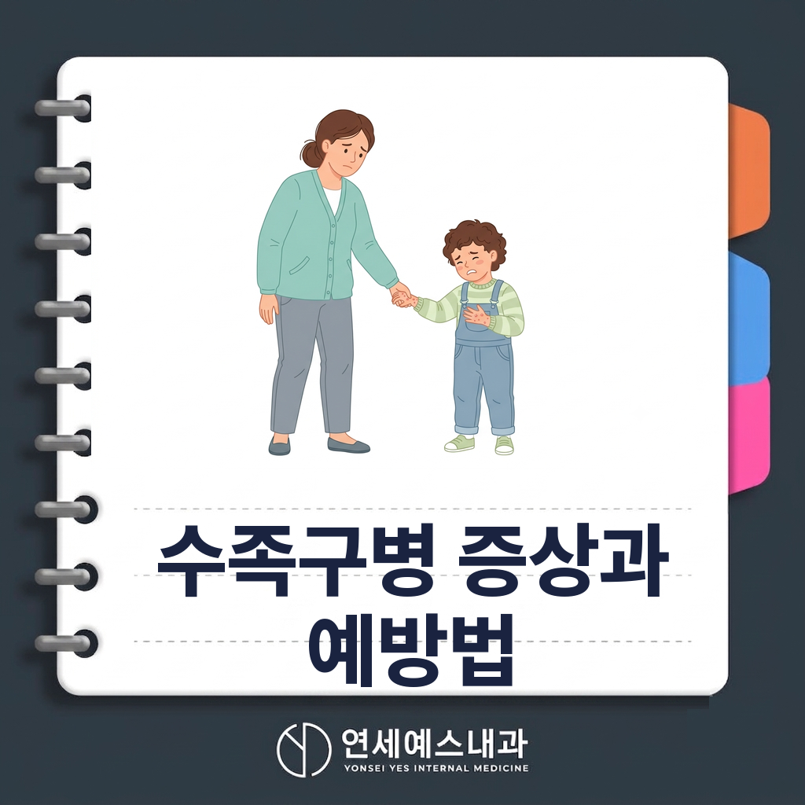

안녕하세요! 여러분의 건강 주치의 연세예스내과입니다. 😊

장마가 물러가고 본격적인 폭염이 시작된 요즘, 어린이집과 유치원에서 **수족구병** 소식이 부쩍 자주 들려오시죠? 아이가 밥을 잘 안 먹고 열이 조금 나는가 싶더니, 입안에 하얀 것이 보이고 손등·발등에 붉은 점이 돋아 놀라신 분들도 많으실 겁니다.

그런데 **"에이, 여름 감기에 뭐가 좀 났겠지"** 하고 며칠 지켜보다가 아이가 물 한 모금도 삼키기 힘들어질 때가 되어서야 병원 문을 두드리는 경우가 적지 않습니다. 수족구병은 대개 저절로 좋아지지만, **탈수와 드문 합병증**이라는 복병을 함께 가진 질환입니다. 오늘은 2026년 유행 상황부터 증상, 위험 신호, 놓치기 쉬운 예방 포인트까지 정리해 드리겠습니다.

---

## 1. 📈 2026년 여름, 수족구병 유행이 이어지고 있습니다

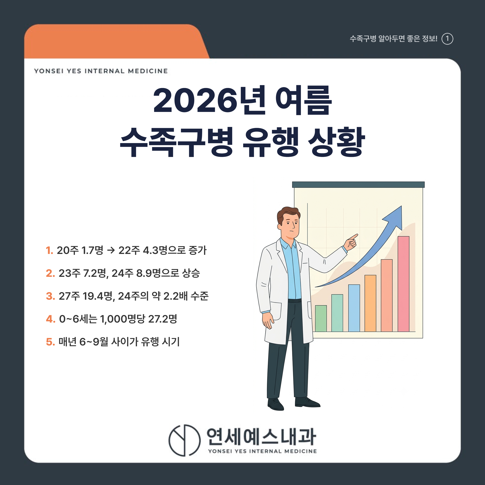

질병관리청은 전국 93개 의원급 의료기관을 표본감시 기관으로 두고 **의사환자분율(외래환자 1,000명당 수족구병 의심 환자 수)**을 주 단위로 집계합니다.

- 20주 1.7명 → 21주 2.3명 → 22주 4.3명으로 오르기 시작
- 23주 7.2명, 24주 8.9명
- **27주 19.4명** — 24주(8.9명)의 약 2.2배 수준 [질병관리청, 2026.7.10 기준]
- 같은 27주 **0~6세는 1,000명당 27.2명**으로 전 연령 평균보다 뚜렷하게 높음

2025년에 발생이 가장 컸던 시기는 33주(8월 10~16일)로 1,000명당 26.4명이었습니다. 수족구병은 **매년 5월경부터 늘기 시작해 6~9월 사이에 유행하는 흐름**이 반복되기 때문에, 지금은 방심하기 어려운 시기입니다.

---

## 2. 🦠 수족구병 원인은 한 가지 바이러스가 아닙니다

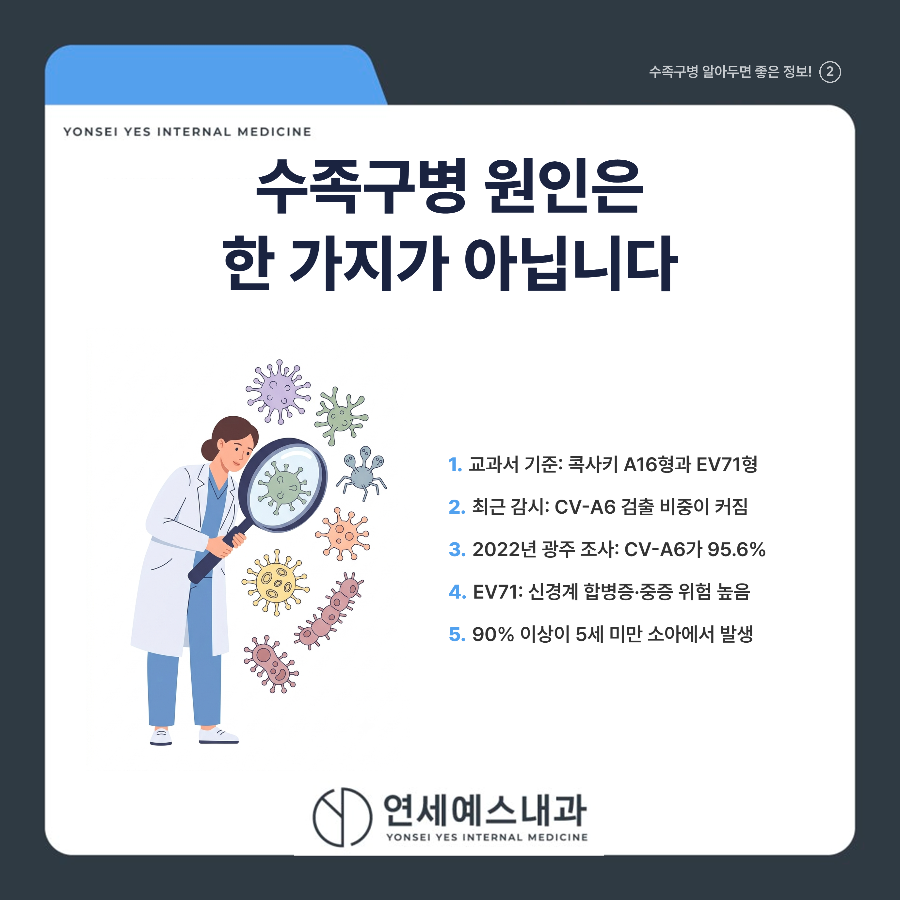

수족구병은 **엔테로바이러스(장바이러스)** 감염으로 생깁니다. 현재 110종 이상의 엔테로바이러스가 확인되어 있는데요, 원인 바이러스를 짚을 때는 두 가지 이야기를 함께 알아두셔야 합니다.

- **교과서·학회 기준**: **콕사키바이러스 A16형**과 **엔테로바이러스 71형(EV71)**이 주된 원인으로 설명됩니다.
- **최근 감시 데이터 기준**: **콕사키바이러스 A6형(CV-A6)**의 비중이 커졌습니다. 2022년 광주 지역 조사에서 엔테로바이러스 검출률은 82.3%(228/277건)였고, 그중 **CV-A6가 95.6%(218/228건)**를 차지했습니다. 중국에서도 2012년 이후 CV-A6가 EV71·CV-A16을 대체해 우세 병원체가 되었다는 보고가 있습니다.

즉 어느 한쪽이 틀린 것이 아니라, **시기별로 유행하는 균주가 달라진 것**입니다. 다만 EV71은 좀 더 눈여겨볼 필요가 있습니다. 무균성 뇌수막염 같은 신경계 질환을 동반할 수 있고, 메타분석에서 EV71 감염은 다른 원인 바이러스보다 중증 수족구병 위험이 높게 나타났습니다(OR 4.44, 95% CI 3.12–6.33). EV71 관련 치명률은 1.7%로 보고됩니다.

수족구병 사례의 **90% 이상은 5세 미만 소아**에서 발생하고, 전체 치명률은 약 0.03% 수준으로 보고되어 있습니다.

---

## 3. 🤲 수족구병은 어떻게 옮고, 언제부터 증상이 나타날까요?

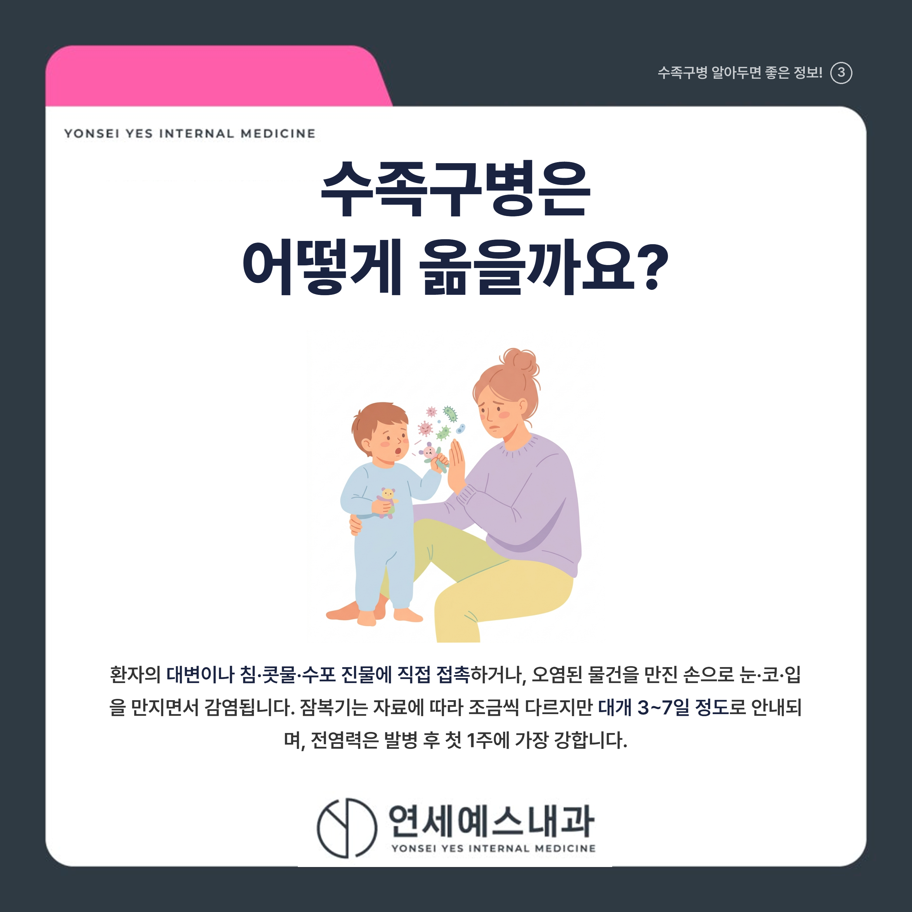

전파 경로는 생각보다 촘촘합니다. 환자의 **대변이나 분비물(침, 가래, 콧물, 수포의 진물 등)에 직접 접촉**하거나, 오염된 물건을 만진 손으로 눈·코·입을 만지는 과정에서 감염됩니다. 그래서 어린이집·유치원의 **장난감이나 문 손잡이 같은 공동 접촉면**이 확산의 통로가 되기 쉽습니다.

잠복기는 **자료에 따라 조금씩 다르게 안내됩니다.** 국내 의료정보 자료는 3~7일, 서울아산병원 자료는 약 4~6일, 해외 의학자료(StatPearls)는 3~6일로 설명합니다. 원인 바이러스 종류와 참조한 원전에 따라 표기가 달라지는 만큼, **"대개 3~7일 정도"라는 범위로 이해하시는 것이 안전합니다.**

전염력은 **발병 후 첫 1주 동안 가장 강합니다.** 인두에서의 바이러스 배출은 대개 4주 미만, 대변에서는 감염 후 약 6주까지 검출될 수 있다고 보고되는데, **배출이 확인되는 기간과 실제 전염력이 강한 기간은 다르다**는 점을 함께 기억해 주세요.

---

## 4. 🌡️ 수족구병 증상, 이런 순서로 나타납니다

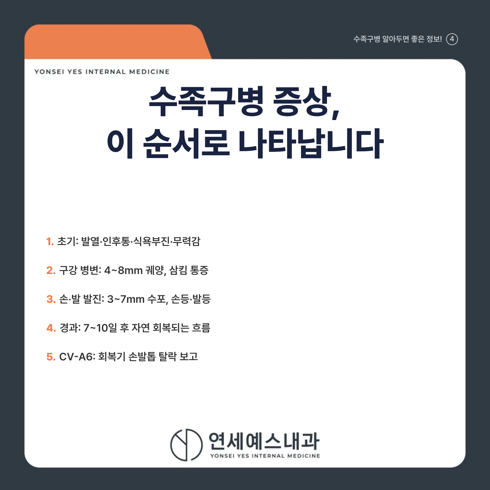

증상은 대체로 아래 흐름을 따릅니다.

**① 초기 (전신 증상)**
발열, 인후통, 식욕부진, 무력감으로 시작하는 경우가 많고 설사·구토 같은 위장관 증상이 함께 나타날 수 있습니다. 2022년 광주 조사에서는 발열이 93.5%(259/277건)에서 확인되었습니다.

**② 구강 병변**
혀, 볼 점막, 후부인두, 구개, 잇몸, 입술에 수포가 생기고, 목젖 주변 연구개에는 점막 궤양이 나타납니다. **4~8mm 크기의 궤양**이 혀·입천장·잇몸·입술에도 생길 수 있습니다. 이 통증 때문에 음식과 물을 삼키기 어려워지는 것이 문제입니다.

**③ 손·발 발진**
**3~7mm 크기의 수포성 발진**이 나타나는데, 손바닥·발바닥보다 **손등과 발등에 더 많이** 생기는 것이 특징입니다. 피부 병변은 2~6mm 크기로 **가렵지 않은 경우가 일반적**이며 약 10일 정도 지속됩니다.

**④ 경과**
수포는 약 1주일이 지나면서 호전되고, 대개 **7~10일 후 자연적으로 회복**될 수 있습니다.

덧붙여 CV-A6 감염에서는 **뒤늦게 손발톱이 빠지는 조갑탈락(onychomadesis)**과 손발 피부 벗겨짐이 보고됩니다. 조갑기질(손발톱이 자라나는 뿌리 조직)이 손상되며 손발톱판이 분리되는 현상인데, 회복기에 나타나 부모님이 크게 놀라는 경우가 많습니다.

---

## Q. 수족구병과 헤르판지나는 어떻게 다른가요?

**가장 큰 차이는 '손발에 발진이 있는지'입니다.** 수족구병은 입안 수포·궤양과 손·발 수포성 발진이 **함께** 나타나지만, 헤르판지나(수포성 인구염)는 목젖 주변과 입천장에만 수포가 생기고 손발에는 발진이 없습니다. 다만 헤르판지나는 38도 이상 고열과 목 통증이 수족구병보다 심한 편입니다.

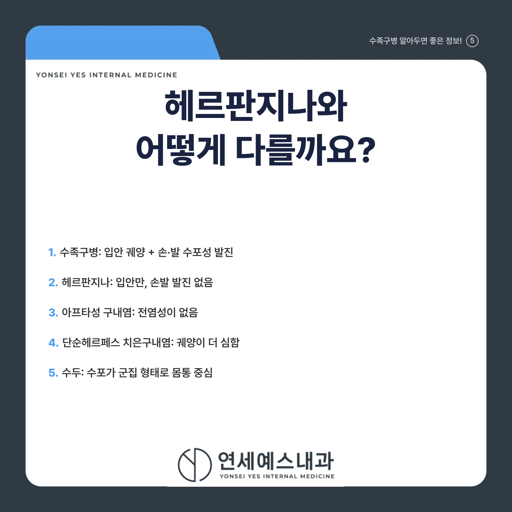

| 질환 | 구분되는 특징 |
|------|---------------|
| **수족구병** | 입안(혀·볼 점막·구개·잇몸) 수포와 4~8mm 궤양 + 손·발 수포성 발진이 함께 나타남 |
| **헤르판지나(수포성 인구염)** | 목젖 주변·입천장에만 수포, 손발 발진 없음. 고열과 목 통증이 더 심한 편 |
| **아프타성 구내염** | 바이러스 감염이 아니며 전염성이 없음 |
| **단순헤르페스 치은구내염** | HSV-1/2에 의한 것으로 궤양이 더 심하게 나타남 |
| **수두** | 수포가 군집(crops) 형태로 몸통 중심에 나타남 |

두 질환은 **모두 입안 수포·궤양이 약 일주일가량 지속되고, 원인이 대변·침·호흡기 분비물에 포함된 장바이러스**라는 공통점이 있습니다. 유행 시기에는 특징적인 임상 양상만으로 진찰에서 판단되는 경우가 많고, 바이러스 검사는 비용과 시간이 들어 특수한 경우를 제외하면 일반적으로 실시하지 않습니다. **실제 구분은 진찰을 통해 이뤄지는 영역**이라는 점을 기억해 주세요.

---

## 5. 🚨 이런 위험 신호는 절대 놓치지 마세요

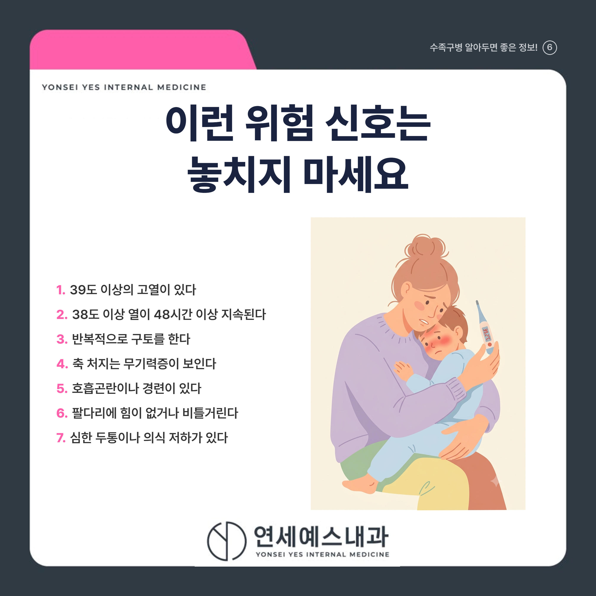

대부분은 자연 회복 경과를 밟지만, 드물게 뇌막염·뇌염 등 중증 합병증으로 이어질 수 있습니다. 아래 항목 중 하나라도 해당된다면 의료기관 진료가 필요하다고 안내됩니다.

- [ ] **39도 이상의 고열**이 있다
- [ ] **38도 이상의 열이 48시간 이상** 지속된다
- [ ] **반복적으로 구토**를 한다
- [ ] 축 처지는 **무기력증**이 보인다
- [ ] **호흡곤란**이나 **경련**이 있다
- [ ] **팔다리에 힘이 없거나 걸을 때 비틀거린다**
- [ ] **심한 두통이나 의식 저하**가 있다

특히 EV71 감염에서는 발열(37~39℃)이 3~7일간 지속되고 구토, 두통, 기면 상태, 깜짝 놀라는 듯한 짧은 경련이 나타날 수 있으며, 증상 발생 후 1~5일 사이에 신경계 합병증으로 진행한 사례도 보고됩니다. **아이 상태가 눈에 띄게 나빠진다면 미루지 말고 가까운 내과나 근처 병의원을 찾으시기 바랍니다.**

---

## 6. 💧 특이 치료제가 없는 만큼, 탈수 관리가 핵심입니다

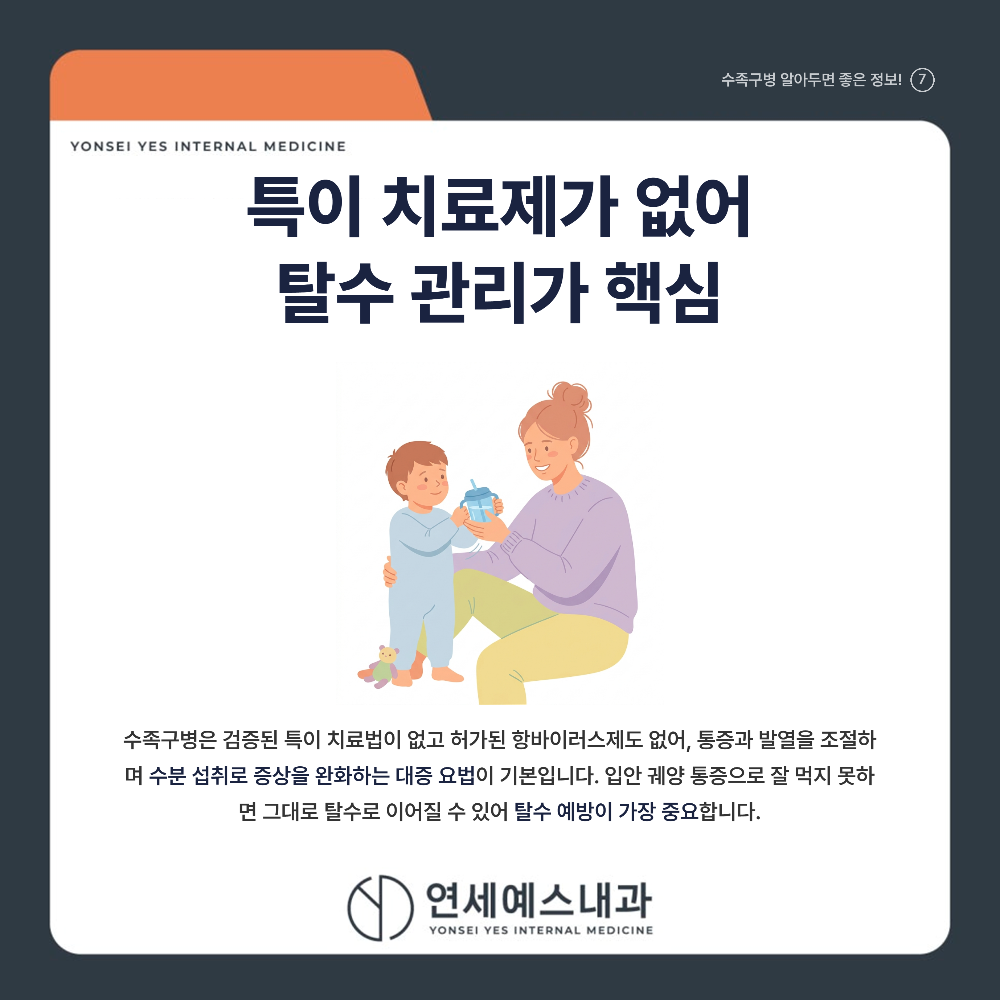

**"약 먹으면 빨리 떨어지지 않나요?"** 하고 물어보시는 분들이 많은데요, 수족구병은 바이러스에 대한 **검증된 특이 치료법이 없고 현재 허가된 항바이러스제도 없습니다.** 그래서 통증과 발열을 조절하고 구강 궤양을 관리하며 **수분 섭취로 증상을 완화하는 대증 요법**이 기본입니다. 증상이 심한 경우에는 입원해 정맥 수액을 투여받기도 합니다.

여기서 가장 중요한 것이 **탈수 예방**입니다. 입안 궤양 통증 때문에 음식과 물을 충분히 먹지 못하면 그대로 탈수로 이어질 수 있습니다. 메타분석에서도 **발열 지속과 구토가 중증화와 연관된 소견**으로 보고되었습니다. 구체적인 약물의 종류와 용량은 아이의 상태에 따라 달라지는 영역이므로, 임의로 판단하지 마시고 진료를 통해 결정하셔야 합니다.

---

## 7. 🧼 알코올 손소독제만으로는 부족할 수 있습니다

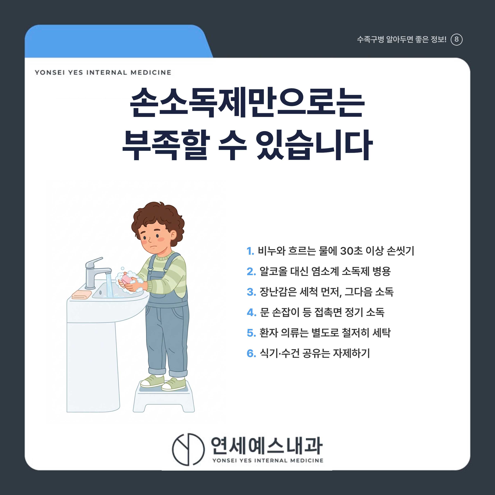

이 부분이 많은 분들이 놓치는 대목입니다. 수족구병을 일으키는 엔테로바이러스는 **외피가 없는(non-enveloped) 바이러스**입니다. 알코올은 바이러스의 지방질 외피를 깨뜨려 작용하는데, 애초에 그 외피가 없으니 **알코올 손소독제만으로는 제거가 충분하지 않을 수 있다**는 것이죠. 그래서 아래 방식이 함께 권고됩니다.

- **비누와 흐르는 물에 30초 이상 손씻기** — 외출 후, 배변 후, 식사 전·후, 기저귀 교체 전·후
- **염소계 소독제 병용** — 알코올 소독제만 의존하지 않기
- **장난감·물건 표면은 비누와 물로 먼저 세척한 뒤 소독제로 닦기** (순서가 중요합니다)
- **자주 만지는 표면(장난감, 문 손잡이) 정기 소독**
- **환자의 의류는 별도로 철저히 세탁**
- 기침·재채기 시 마스크 사용, **식기·수건 공유 자제**

등원·등교 기준은 질병관리청 안내를 기준으로 삼는 것이 좋습니다. 질병관리청은 수족구병에 걸린 영유아가 **증상 발생 기간 중 전염력이 강하므로 회복될 때까지, 즉 수포가 완전히 나을 때까지 등원·등교를 자제**하도록 안내했습니다(2026년 7월 안내 기준). 한편 EV71형을 별도로 다루는 보건소 안내는 증상 발생 후 2주간 보육시설·공공장소 이용 자제, 수영은 6주간 자제로 더 긴 기간을 제시하기도 합니다. **"물집만 마르면 보내도 되겠지"** 하고 스스로 판단하기보다, 개별 등원 시점은 진료를 통해 확인하시는 편이 좋습니다.

---

## Q. 수족구병 예방백신은 맞을 수 있나요?

**국내에는 허가된 수족구병 예방백신과 특이 치료제가 없습니다.** 미국에도 허가된 백신이 없습니다. 중국에서는 2015년 말 이후 EV-A71 불활화 백신이 허가되어 생후 6개월~71개월 소아를 대상으로 사용되고 있습니다.

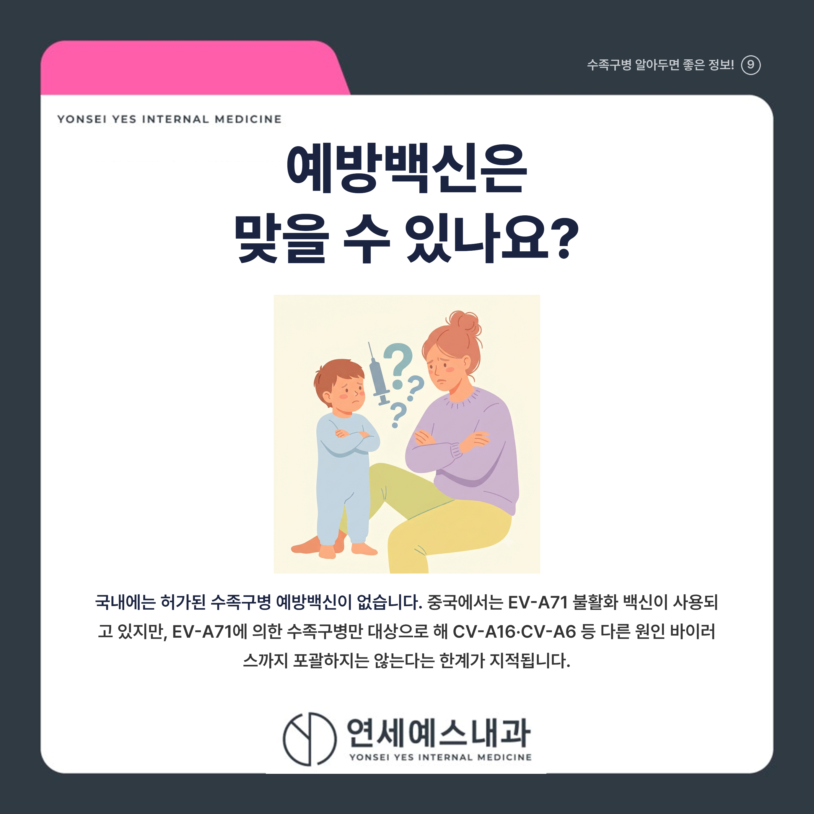

다만 이 백신에는 분명한 한계가 있습니다. **EV-A71에 의한 수족구병만을 대상으로 하기 때문에, CV-A16이나 CV-A6 등 다른 원인 바이러스에 의한 수족구병까지 포괄하지는 않는다**는 점이 문헌에서 지적됩니다. 최근 국내외 감시에서 CV-A6 비중이 커진 흐름을 고려하면 더욱 그렇습니다. 결국 지금 우리가 쓸 수 있는 카드는 **손 위생과 환경 소독, 그리고 회복까지의 등원 자제**입니다.

---

## 8. 👨‍👩‍👧 어른도 안심할 수 없습니다

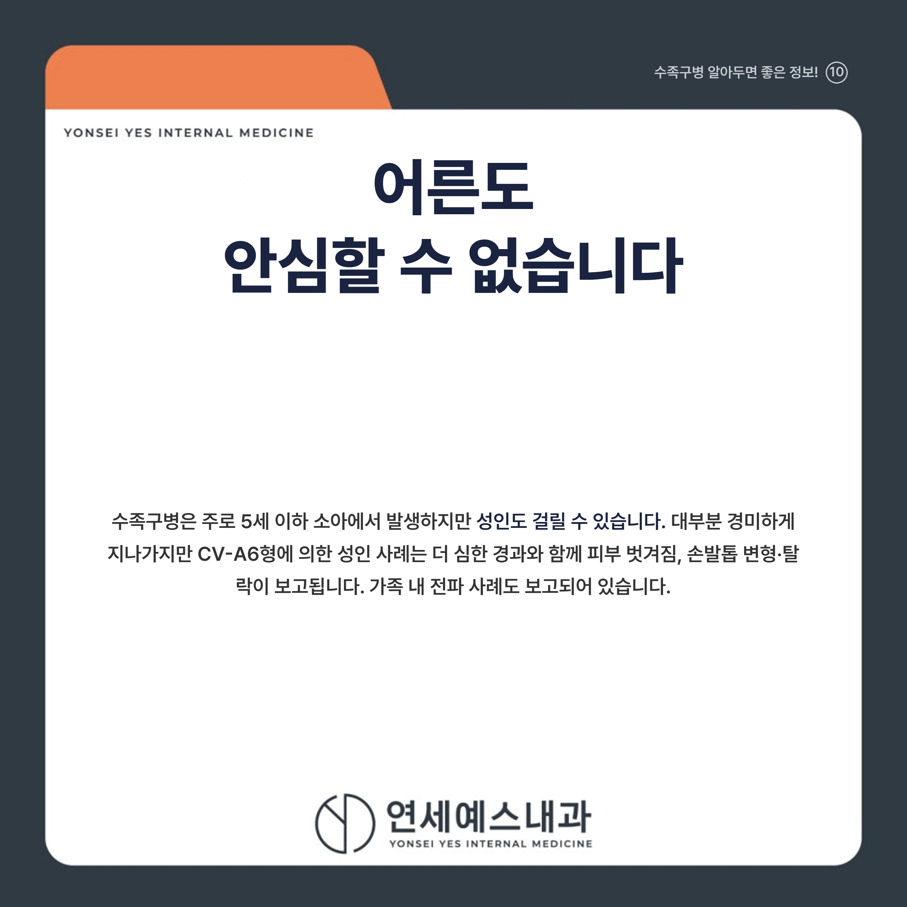

수족구병은 주로 5세 이하 소아에서 발생하지만 **성인에게서도 발생할 수 있습니다.** 대부분의 성인은 관련 바이러스에 대한 면역이 있어 경미하게 지나가는 경우가 많다고 설명되지만, **CV-A6형에 의한 성인 수족구병은 더 심한 경과와 함께 지연성 피부 벗겨짐, 손발톱 변형·탈락을 동반한다는 보고**가 있습니다. 성인 비전형 사례 분석에서는 전원 손등·손바닥에 수포성 발진이 있었고 87%에서 얼굴 병변, 27%에서 발바닥 병변이 확인되었습니다.

가족 내에서 아이로부터 건강한 성인에게 전파된 사례도 문헌에 보고되어 있으니, **기저귀를 갈고 손을 대충 씻는 습관**은 이 시기만큼은 꼭 고쳐주세요.

---

## ✅ 수족구병, 이것만은 꼭 기억하세요

| 항목 | 핵심 내용 |
|------|----------|
| 유행 시기 | 5월경부터 증가, 6~9월 유행. 27주 기준 1,000명당 19.4명(0~6세 27.2명) |
| 원인 | 교과서적으로 CV-A16·EV71, 최근 감시에서는 CV-A6 검출 비중 높음 |
| 잠복기 | 자료에 따라 다르며 대개 3~7일 정도로 안내됨 |
| 증상 | 발열·인후통 → 입안 4~8mm 궤양 → 손등·발등 3~7mm 수포. 7~10일 자연 회복 경과 |
| 치료 | 특이 치료제 없음. 대증 요법과 수분 섭취·탈수 예방이 중심 |
| 위험 신호 | 39도 이상 고열, 38도 이상 48시간 지속, 반복 구토, 무기력, 호흡곤란, 경련, 보행 시 비틀거림 |
| 예방 | 비누와 흐르는 물 30초 손씻기 + 염소계 소독제 병용, 수포 나을 때까지 등원 자제 |

> **"수족구병은 약으로 끊어내는 병이 아니라, 잘 먹이고 잘 씻겨서 지나 보내는 병입니다."**

아이가 입안 통증으로 물조차 삼키기 힘들어하거나, 위 위험 신호 항목에 해당하는 모습이 보인다면 지켜보는 시간을 늘리지 마시고 **가까운 내과나 근처 병의원에 편안하게 걸음 하셔서** 전문의와 상담해 보시기 바랍니다. 수족구병은 어른도 같은 바이러스에 노출될 수 있는 질환이니, 올여름은 온 가족이 함께 손을 씻는 습관으로 지나 보내시면 좋겠습니다.

---

※ 모든 치료 및 예방접종은 개인의 상태에 따라 발열, 통증, 알레르기 반응 등의 부작용이 나타날 수 있으므로, 반드시 의료진과 충분한 상담 후 진행하시기 바랍니다.

연세예스내과에서 전해드리는 건강 정보였습니다. 오늘도 건강하고 평안한 하루 보내세요!

---

#수족구병 #수족구증상 #수족구예방 #주안역의원 #주안역내과의원 #시민공원역내과 #시민공원역의원 #시민공원역내과의원 #주안사거리내과 #주안사거리의원
