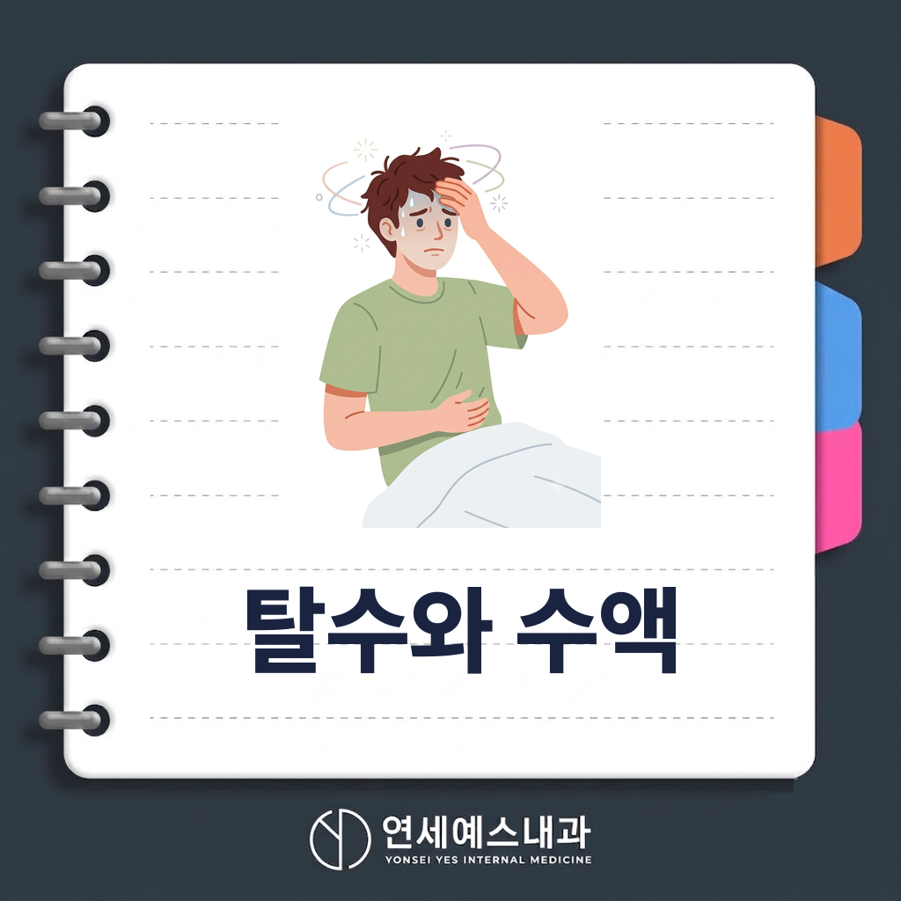
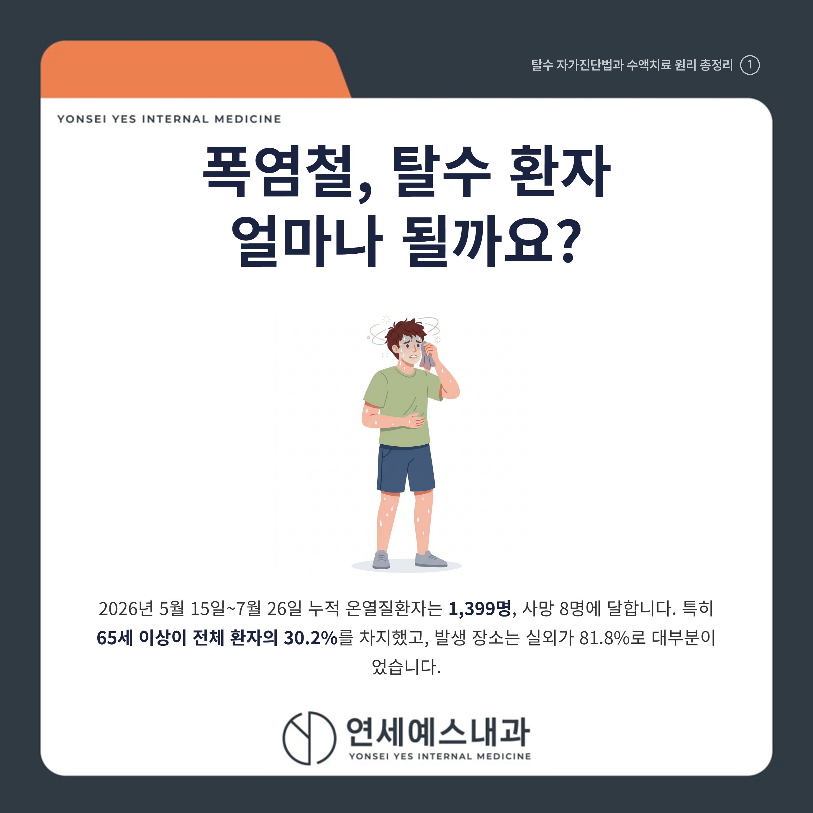
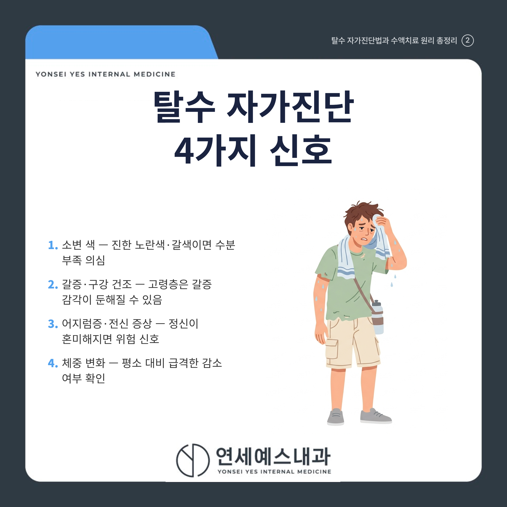
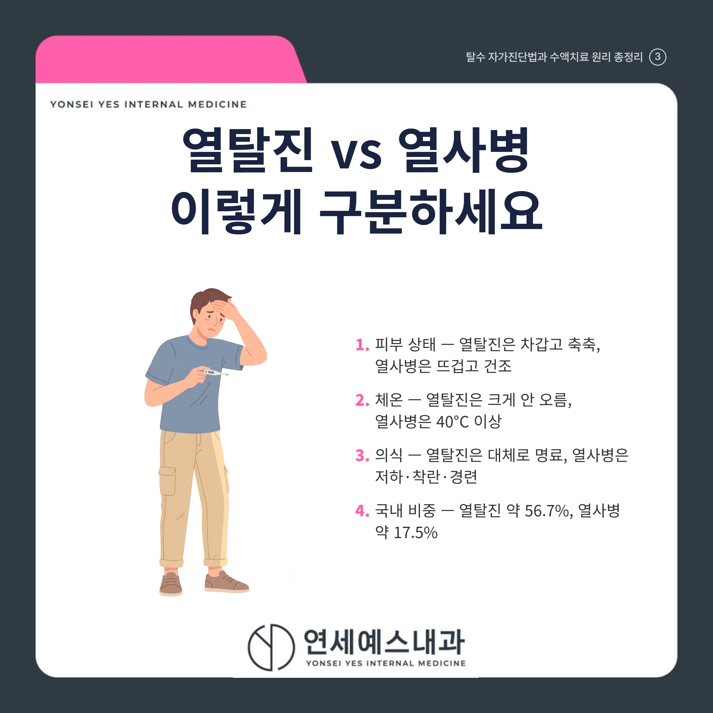
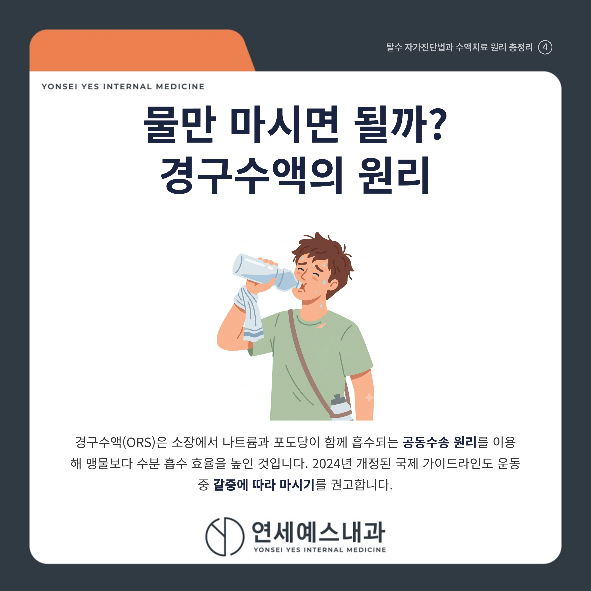
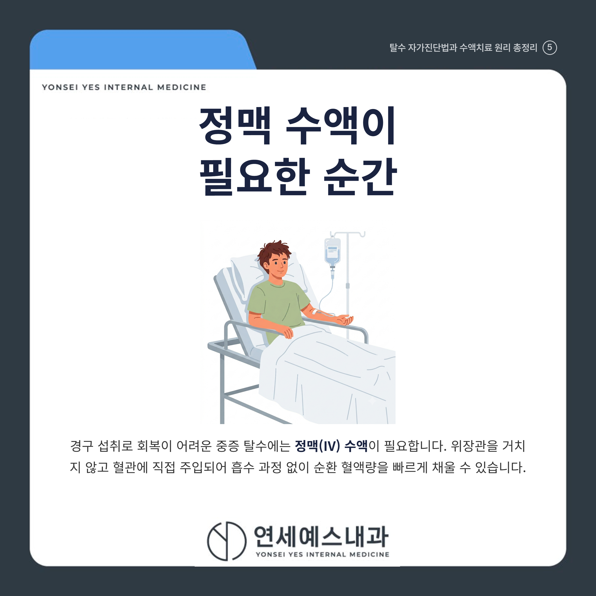
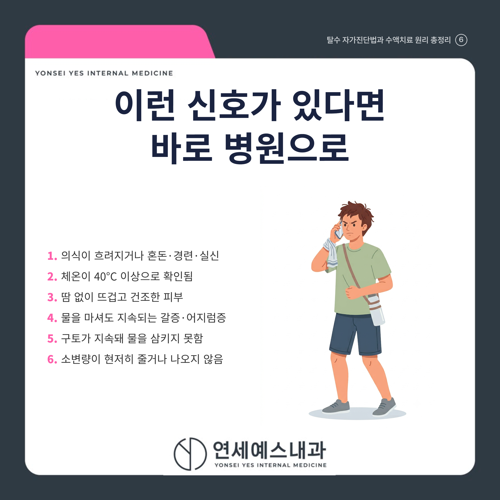

# [주안동내시경내과연세예스내과] 탈수 자가진단법과 수액치료 원리 총정리

안녕하세요! 여러분의 건강 주치의 연세예스내과입니다. 😊

연일 이어지는 폭염 속에서 탈수, 남의 일이 아니라고 느끼시죠? 밖에 잠깐만 나갔다 와도 온몸이 축 늘어지는데도 "물 좀 마시면 괜찮아지겠지" 하며 대수롭지 않게 넘기시는 분들 많으실 텐데요, 탈수를 방치하면 열탈진(Heat Exhaustion)이나 열사병으로 빠르게 진행될 수 있는 위험한 신호입니다. 오늘은 스스로 확인할 수 있는 탈수 자가진단 방법과, 경구 수분 섭취만으로 부족할 때 왜 수액 치료가 필요한지 그 원리를 정리해 드리겠습니다.

---

## 1. 🌡️ 폭염철, 탈수 환자 얼마나 될까요?

질병관리청 온열질환 응급실감시체계 집계에 따르면, 2026년 5월 15일부터 7월 26일까지 누적 온열질환자는 1,399명, 이 중 사망자는 8명에 달합니다. 특히 **65세 이상 고령층이 전체 환자의 30.2%를 차지**했고, 사망자 8명 중 7명이 65세 이상이었다는 점은 눈여겨봐야 할 대목입니다. 발생 장소는 실외가 81.8%로 대부분을 차지했으며, 그중에서도 작업장(26.2%), 논밭(15.9%), 길가(12.4%) 순으로 많았습니다. "설마 나는 괜찮겠지"라는 안일한 생각이 가장 위험한 법이죠.

---

## 2. 🔍 이 4가지 신호, 탈수 자가진단 체크포인트

탈수는 갑자기 쓰러지는 것이 아니라 몸이 미리 보내는 신호를 거치며 진행됩니다. 아래 네 가지를 꼭 확인해 보세요.

- **소변 색**: 몸이 탈수되면 항이뇨호르몬(바소프레신) 분비가 늘어 소변이 진하고 양이 줄어듭니다. 옅은 미색이 아니라 진한 노란색·갈색에 가깝다면 수분 부족을 의심할 수 있습니다.
- **갈증·구강 건조**: 갈증, 입안이 마르고 침이 끈적해지는 느낌은 비교적 초기에 나타나는 신호입니다. 다만 **고령층은 갈증을 느끼는 감각 자체가 둔해져 있어** "목이 안 마르니 괜찮다"는 판단이 오히려 위험할 수 있습니다.
- **어지럼증·전신 증상**: 두통, 어지럼증, 피로감이 흔하며, 심해지면 일어설 때 핑 도는 기립성 저혈압이나 실신으로 이어질 수 있습니다. 특히 **정신이 혼미해지는 증상은 탈수가 위험한 단계에 이르렀다는 가장 중요한 경고**로 꼽힙니다.
- **체중 변화**: 평소 체중 대비 급격한 감소가 다른 탈수 증상과 함께 나타난다면 중등도 이상을 의심할 수 있습니다. 정확한 감소율보다는 "평소와 다른 급격한 변화 + 동반 증상"을 함께 살피는 것이 실용적입니다.

---

## 3. 🚨 열탈진과 열사병, 이렇게 구분하세요

단순 탈수인지, 생명을 위협하는 열사병인지 구분하는 것이 가장 중요합니다. **"땀이 나니까 괜찮겠지"라고 안심하시는 분들이 많은데, 절대 그렇지 않습니다.**

| 구분 | 열탈진(일사병) | 열사병 |
|------|---------------|--------|
| 피부 상태 | 차갑고 축축함 | 뜨겁고 건조함(땀이 잘 안 남) |
| 체온 | 크게 오르지 않음 | 40°C 이상 |
| 의식 | 대체로 명료 | 의식 저하·착란·경련 동반 |
| 국내 비중 | 약 56.7% | 약 17.5% |

다만 운동이나 노동 중 발생하는 열사병은 땀이 나는 상태에서도 발생할 수 있어, "땀이 나면 열사병이 아니다"라고 단정할 수는 없다는 점도 꼭 기억해 두세요.

---

## 4. 💧 물만 마시면 될까? 경구 수분과 정맥 수액의 차이

가벼운 탈수는 물이나 경구수액(ORS, Oral Rehydration Solution)으로 충분히 회복됩니다. ORS는 소장에서 나트륨과 포도당이 함께 흡수되는 공동수송(co-transport) 원리를 이용해, 맹물만 마실 때보다 수분 흡수 효율을 높인 것입니다. 실제로 2024년 개정된 국제 임상 가이드라인(Wilderness Medical Society)도 운동 중에는 **갈증에 따라 마시기(drink-to-thirst)** 방식으로 체중 2% 이상 손실을 막을 것을 권고하고 있습니다.

문제는 경구 섭취가 위장관 흡수 속도의 한계를 갖는다는 점입니다. 의식이 흐려지거나 구토가 계속돼 물을 삼키지 못하는 상태, 혹은 손실량이 큰 중증 탈수에서는 경구 섭취만으로 회복이 따라가지 못합니다. 이럴 때 필요한 것이 바로 **정맥(IV) 수액**입니다. 정맥 수액은 위장관을 거치지 않고 수분과 전해질을 혈관에 직접 주입하므로, 흡수 과정 없이 순환 혈액량을 빠르게 채울 수 있다는 점이 경구 섭취와의 핵심 차이입니다. 열사병 치료에서는 생리식염수 같은 등장액을 정맥으로 투여해 전해질 균형을 회복시키며, 냉각된 수액을 사용하면 체온을 낮추는 보조 효과도 함께 얻을 수 있습니다.

---

## Q. 물을 마셔도 어지러운데, 언제 병원에 가야 하나요?

물을 마셔도 어지럼증이나 갈증이 계속되거나, 의식이 흐려지고 혼란스러운 모습, 구토가 지속돼 물을 유지하지 못하는 상태라면 스스로 수분을 보충하기보다 **즉시 병원·응급실 방문 또는 119 신고가 필요한 상황**입니다.

아래 신호 중 하나라도 해당된다면 지체하지 마세요.

[   ] 의식이 흐려지거나 혼돈, 지남력 상실, 경련, 실신이 나타난다

[   ] 체온이 40°C 이상으로 확인된다

[   ] 땀이 나지 않으면서 피부가 뜨겁고 건조하다

[   ] 물을 마셔도 갈증·어지럼증이 계속되거나 일어설 때 핑 돈다

[   ] 구토가 지속돼 물을 삼키거나 유지하지 못한다

[   ] 소변량이 현저히 줄거나 나오지 않는다

고온 환경에 노출된 사람에게 이런 뇌 기능 이상 징후가 나타나면, 주저하지 말고 구급차를 부르는 것이 가장 안전합니다.

---

## ✅ 오늘의 탈수 자가진단 요약

| 체크 항목 | 확인 방법 |
|-----------|-----------|
| 소변 색 | 옅은 미색인지, 진한 갈색인지 확인 |
| 갈증·구강 상태 | 입 마름·끈적임 여부 확인 |
| 어지럼증·전신 증상 | 두통·기립성 어지럼 여부 확인 |
| 체중 변화 | 평소 대비 급격한 감소 여부 확인 |

> **"탈수는 물 한 잔으로 넘길 수 있을 때 알아채는 것이 가장 안전합니다."**

경구 수분으로 회복되지 않거나 위 체크리스트 중 하나라도 해당된다면, 참지 마시고 **가까운 내과**에 들러 전문의와 상담해 보시기 바랍니다. 특히 고령층이나 만성질환이 있으신 분들은 증상이 가볍더라도 미루지 마시고 가까운 내과를 방문하시길 권해드립니다.

---

※ 모든 치료 및 예방접종은 개인의 상태에 따라 발열, 통증, 알레르기 반응 등의 부작용이 나타날 수 있으므로, 반드시 의료진과 충분한 상담 후 진행하시기 바랍니다.

연세예스내과에서 전해드리는 건강 정보였습니다. 오늘도 건강하고 평안한 하루 보내세요!

---

#탈수자가진단 #열사병 #온열질환 #주안사거리내과의원 #미추홀내과 #미추홀의원 #미추홀내과의원 #옛시민회관내과 #옛시민회관의원 #옛시민회관사거리내과
