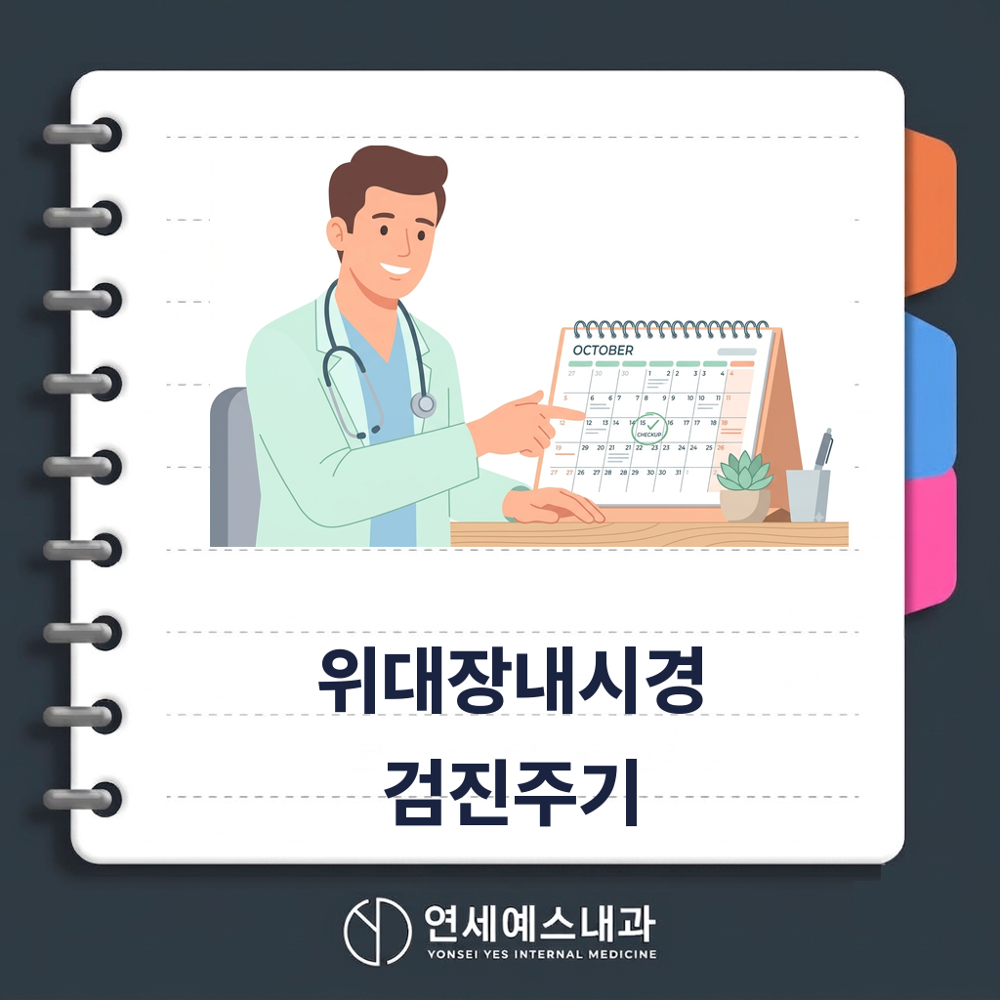
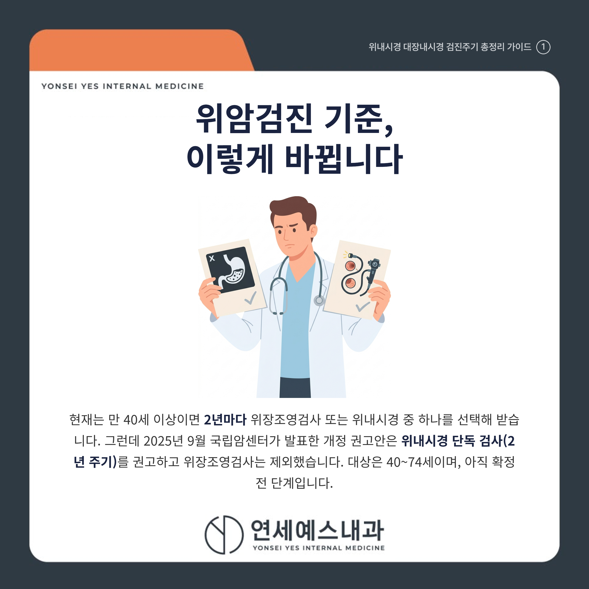
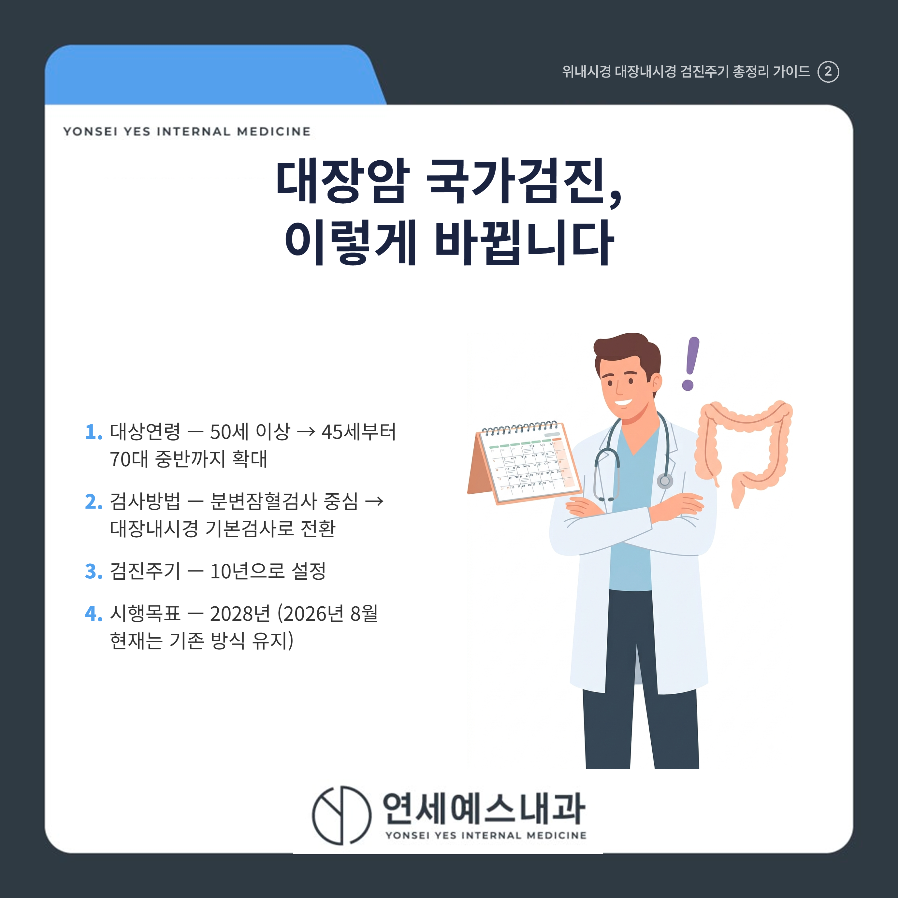
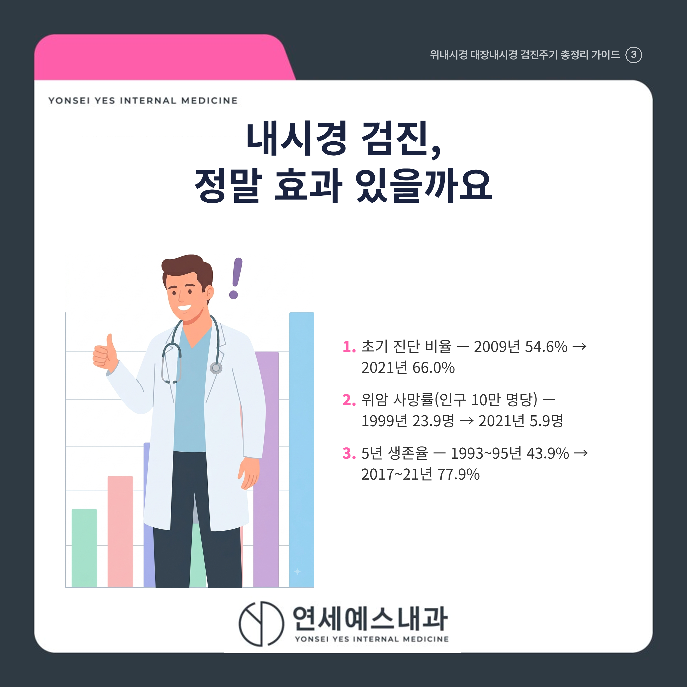
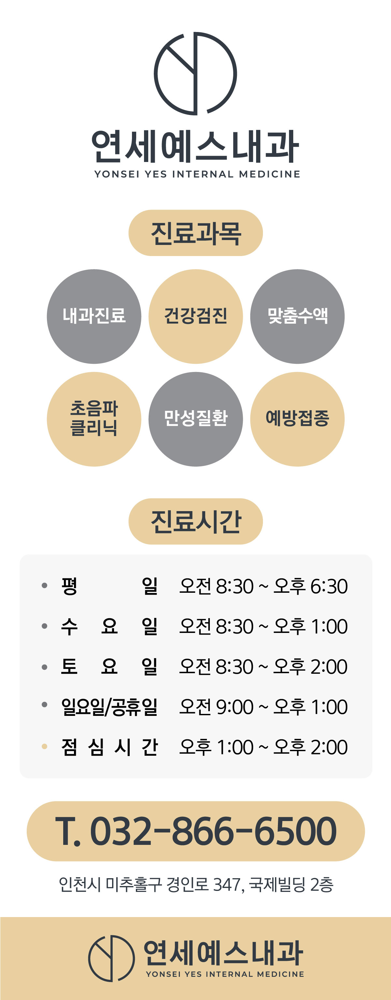

# [주안동주말진료내과연세예스내과] 위내시경 대장내시경 검진주기 총정리 가이드

안녕하세요! 여러분의 건강 주치의 연세예스내과입니다. 😊

장마가 걷히고 다시 무더위가 이어지는 요즘, 건강검진 안내 문자를 받고도 "올해도 그냥 넘어갈까" 하고 미루신 분들 많으시죠? 특히 위내시경과 대장내시경은 검진주기를 헷갈려 하시는 분들이 유독 많습니다. "작년에 받았으니 올해는 괜찮겠지", 혹은 "아직 40대인데 벌써 대장내시경을?"이라며 넘기기 쉬운데, 최근 국가암검진 권고안과 정책이 잇따라 개정되면서 예전 기준을 그대로 알고 계시면 오히려 검진 시기를 놓칠 수 있습니다. 오늘은 2026년 8월 현재 기준으로 위내시경과 대장내시경의 정확한 검진주기와 나이 기준, 그리고 최근 발표된 개정 내용까지 한 번에 정리해 드리겠습니다.

---

## 1. 🔍 위내시경, 몇 살부터 얼마나 자주 받아야 할까요?

현재 시행 중인 국가암검진 제도에서는 만 40세 이상 남녀라면 증상이 없어도 **2년마다** 위장조영검사 또는 위내시경 검사 중 하나를 선택해 받도록 안내하고 있습니다. 위장조영검사에서 이상 소견이 나오면 위내시경을 추가로 받고, 위내시경에서 암이 의심되면 바로 조직검사를 진행하는 방식입니다.

그런데 이 기준이 곧 바뀔 가능성이 있습니다. 국립암센터는 2025년 9월, 10년 만에 개정한 '국가 위암 검진 권고안(2025)'을 발표했는데, 핵심은 **위내시경 검사(2년 간격)를 단독 1차 검진 방법으로 권고**하고 위장조영검사는 선택지에서 제외한 것입니다. 대상 연령은 40~74세 무증상 성인이며, 75세 이상은 개인의 건강 상태와 기대 여명을 고려해 의료진과 상담 후 검진 여부를 결정하도록 안내합니다. 다만 이 권고안은 아직 추가 검토를 거쳐 최종 확정되는 단계로, **국가암검진사업 고시에 곧바로 반영된 것은 아니라는 점**은 꼭 기억해 주세요.

한 가지 더 참고할 만한 근거가 있습니다. 국내 연구진이 위암 검진 25가지 전략을 비교분석한 결과, 내시경 단독으로 3년 주기, 상한 연령 69세로 시행하는 전략의 비용 대비 효과가 가장 우수한 것으로 나타났습니다. 반면 위장조영검사를 포함한 현행 전략은 상대적으로 비효율적이라는 결과도 함께 제시됐습니다.

---

## 2. 🩺 대장내시경 검진주기, 곧 큰 폭으로 바뀝니다

지금은 만 50세 이상이면 **매년** 분변잠혈검사(대변 속 혈액을 확인하는 검사)를 받고, 양성 판정을 받은 경우에만 대장내시경 또는 대장이중조영검사를 선택해 받는 방식입니다. "매년 대변검사만 하면 되는 거 아니야?"라고 생각하실 수 있지만, 곧 이 기준도 크게 달라집니다.

보건복지부는 2026년 2월 24일 국가암관리위원회를 열어 '제5차 암관리종합계획(2026~2030)'을 심의·의결했습니다. 이 계획에 따르면 대장암 국가검진 대상 연령을 기존 50세 이상에서 **45세부터 70대 중반까지**로 넓히고, 검진 방법도 분변잠혈검사 중심에서 **대장내시경을 기본검사로 도입**하는 방향으로 개편하며, 검진 주기는 **10년**으로 설정할 예정입니다. 시행 목표 시기는 **2028년**입니다. 개편 배경에는 분변잠혈검사의 낮은 정확도와 불편함, 그리고 2024년 기준 대장암 검진 수검률이 6대암 중 가장 낮은 40.3%에 그쳤다는 점이 꼽힙니다.

**다만 이 개편안은 아직 시행 전 계획 단계**이며, 2026년 8월 현재는 여전히 기존 방식(만 50세 이상, 매년 분변잠혈검사)이 운영되고 있다는 점을 헷갈리지 마셔야 합니다. 참고로 미국암학회는 2026년 개정 가이드라인에서 평균 위험군 성인의 대장암 검진 시작 연령을 45세로 재확인하고, 기대여명이 10년 이상이면 75세까지 검진을 지속하도록 권고하고 있어 국내 개편 방향과 비슷한 흐름을 보이고 있습니다.

---

## 3. ⚠️ 가족력이 있다면 더 서둘러야 하는 이유

**"우리 집안에 대장암 있었던 사람 없는데 뭘"**이라고 안심하고 계신가요? 가족력이 있는 경우라면 국가검진 기준보다 훨씬 이르게, 그리고 더 자주 검사받아야 합니다.

대장암 가족력이 있는 경우, **가족 내 최연소 암 발병 연령보다 10년 이르게** 검진을 시작하거나, 혹은 **40세부터** 검진을 시작하도록 권고됩니다. 미국암학회 2026년 개정 가이드라인 역시 부모·형제자매·자녀 같은 1촌 가족이 60세 이전에 대장암이나 진행성 용종 진단을 받은 경우 **5년 주기**의 대장내시경 검진을 권고하고 있습니다.

다음 항목 중 하나라도 해당된다면 정해진 국가검진 주기보다 이른 상담이 필요할 수 있습니다.

[   ] 부모, 형제자매 등 1촌 가족이 60세 이전에 대장암이나 진행성 용종 진단을 받은 적 있다

[   ] 궤양성대장염, 크론병 같은 염증성 장질환을 앓고 있다

[   ] 가족성 선종성 용종증(FAP)이나 린치증후군 등 유전성 질환 병력이 있다

[   ] 가족 중 연소기 용종이나 대장암 병력이 있는 사람이 있다

[   ] 만 40세가 지났는데 위내시경이나 대장내시경을 한 번도 받아본 적 없다

궤양성 대장염, 크론병, 포이츠-예거 증후군, 가족성 선종성 용종증(FAP), 린치증후군(유전성 비용종증 대장암) 등의 병력이 있다면 고위험군으로 분류되므로, 전문의와 상담해 개별 검사 방법과 검사 간격을 따로 정해야 합니다. 반대로 대장암 가족력이 없고 첫 대장내시경에서 이상 소견이 없었던 저위험군은 **일부 연구에서는** 검진 주기를 최대 15년까지 늘려도 큰 문제가 없다는 결과도 보고된 바 있으나, 이는 국내 공식 가이드라인으로 아직 채택된 수치는 아니므로 참고 수준으로만 받아들이시는 것이 안전합니다.

---

## 4. 📊 내시경 검진, 정말 효과가 있을까요?

**결론부터 말씀드리면, 그렇습니다.** 국내 위암 검진 성과를 분석한 연구에 따르면 2022년 위암 검진 수검률은 63.8%였고, 같은 해 내시경 검진 건수는 약 784만 건으로 2002년(22만 건) 대비 무려 35배 늘었습니다.

그 결과 초기 단계에서 위암이 진단되는 비율은 2009년 54.6%에서 2021년 66.0%로 늘었고, 위암의 연령표준화 사망률은 1999년 인구 10만 명당 23.9명에서 2021년 5.9명으로 크게 줄었습니다. 5년 상대생존율도 1993~1995년 43.9%에서 2017~2021년 77.9%로 눈에 띄게 향상됐습니다. 2025년 발표된 체계적 문헌고찰(약 40만 명 데이터 분석)에서도 내시경 검진을 통한 전암성 병변 발견율이 25.5%, 위 신생물성 병변 발견율이 3.3%였고, 이 중 조기암 비율이 91.6%에 달해 **내시경 검진이 조기 발견에 실질적으로 효과적**이라는 점이 뒷받침됐습니다.

위내시경을 받을 계획이라면 **헬리코박터균 검사를 함께 받는 것**도 고려해 보세요. 내시경 검사 중 조직검사를 통해 헬리코박터 파일로리균 감염 여부를 바로 확인할 수 있어, 위내시경 검진에 헬리코박터 제균치료를 병행하는 것이 비용 대비 효과적이라는 연구 결과도 있습니다. 40세에 제균치료를 시행하는 경우 질보정수명(QALY) 1 증가당 약 140만 4,382원의 비용이 소요돼, 가장 비용 효과적인 시나리오로 분석됐습니다.

---

## Q. 수면내시경과 비수면내시경, 어떤 게 더 안전한가요?

두 방식 모두 출혈, 장 천공, 감염 같은 합병증이 발생할 수 있지만 **매우 드뭅니다.** 수면내시경은 편안하게 검사받을 수 있는 대신 호흡곤란·저산소증 같은 호흡기계 합병증, 심박수 증가, 낙상 등의 부작용이 있을 수 있고, 대개는 별도 조치 없이 호전됩니다.

다만 극히 드물게 호흡·심정지처럼 생명이 위협받는 상황이나 과민반응에 대한 응급조치가 필요한 경우도 보고되는 만큼, 고령이거나 폐기능 장애·심질환·급성질환이 있는 분들은 진정제 사용이 제한될 수 있습니다. 검사를 편안하게 받고 싶다면 수면내시경이 적합할 수 있지만, 약물 알레르기가 있거나 기저질환이 있는 고령 환자라면 비수면내시경이 권장되는 경우도 있으니, 본인의 건강 상태를 미리 의료진에게 알리고 상의하시는 것이 가장 안전합니다.

---

## ✅ 위·대장내시경 검진주기 한눈에 정리

| 구분 | 현재 시행 중인 제도 | 개정 권고안·계획 |
|------|------|------|
| 위암 검진 | 40세 이상, 2년마다 위장조영검사 또는 위내시경 선택 | 40~74세, 위내시경 단독 2년 주기 (2025년 9월 국립암센터 권고안, 확정 전) |
| 대장암 검진 | 50세 이상, 매년 분변잠혈검사 → 양성 시 대장내시경 | 45세~70대 중반, 대장내시경 기본검사 10년 주기 (2028년 시행 목표) |
| 가족력·고위험군 | — | 최연소 발병 연령보다 10년 이르게 또는 40세부터 시작 |

> **"오늘 놓친 검진주기가 10년 뒤 조기 발견의 기회를 놓치게 만들 수 있습니다."**

위내시경과 대장내시경 모두 검진주기와 개정 기준이 계속 바뀌고 있는 만큼, 본인의 연령과 가족력에 맞는 검진 시기가 헷갈리신다면 미루지 마시고 **가까운 내과에 방문해 전문의와 상담**해 보시기 바랍니다.

---

※ 모든 치료 및 예방접종은 개인의 상태에 따라 발열, 통증, 알레르기 반응 등의 부작용이 나타날 수 있으므로, 반드시 의료진과 충분한 상담 후 진행하시기 바랍니다.

연세예스내과에서 전해드리는 건강 정보였습니다. 오늘도 건강하고 평안한 하루 보내세요!

---

#대장내시경검진주기 #위암검진 #대장암검진 #옛시민회관사거리내과 #옛시민회관사거리의원 #옛시민회관사거리내과의원 #석바위내과 #석바위의원 #석바위내과의원 #위내시경
