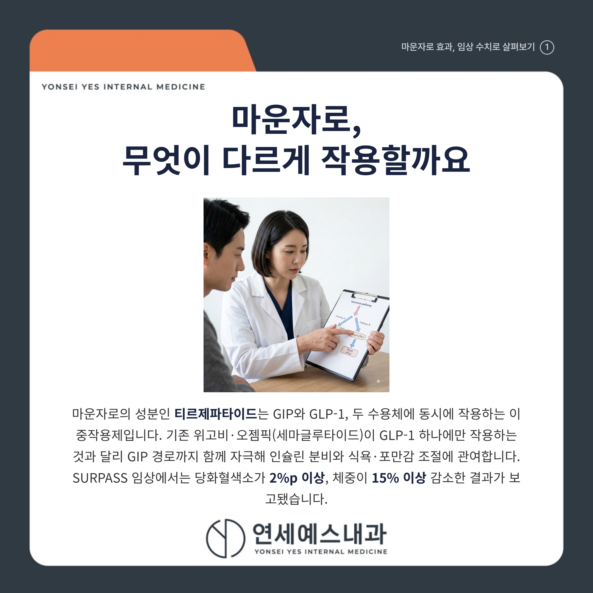
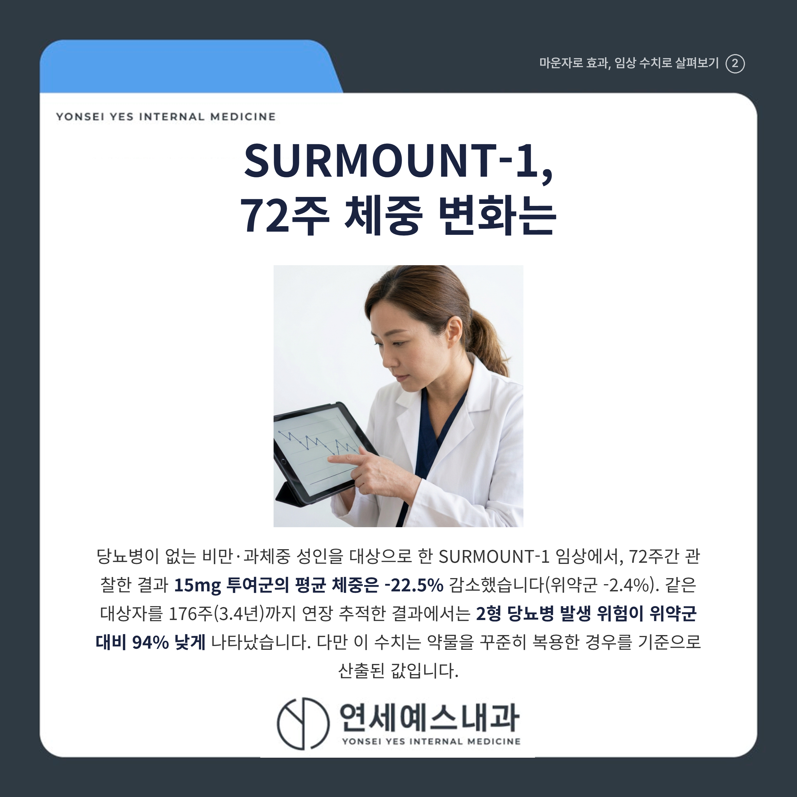
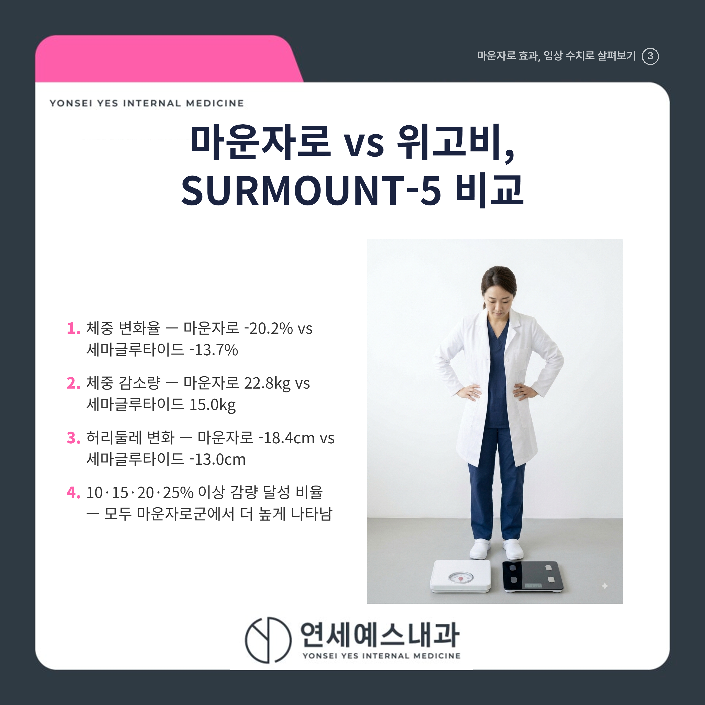
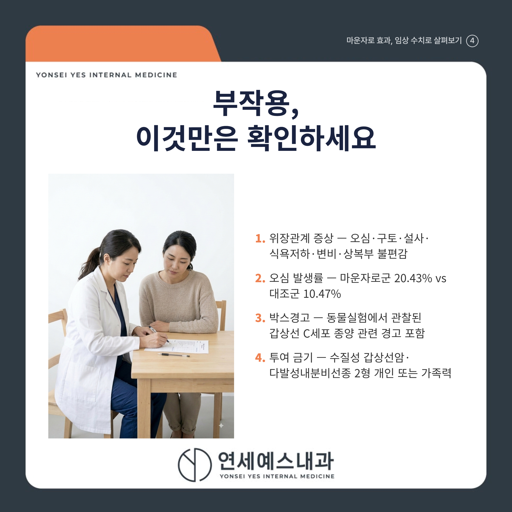
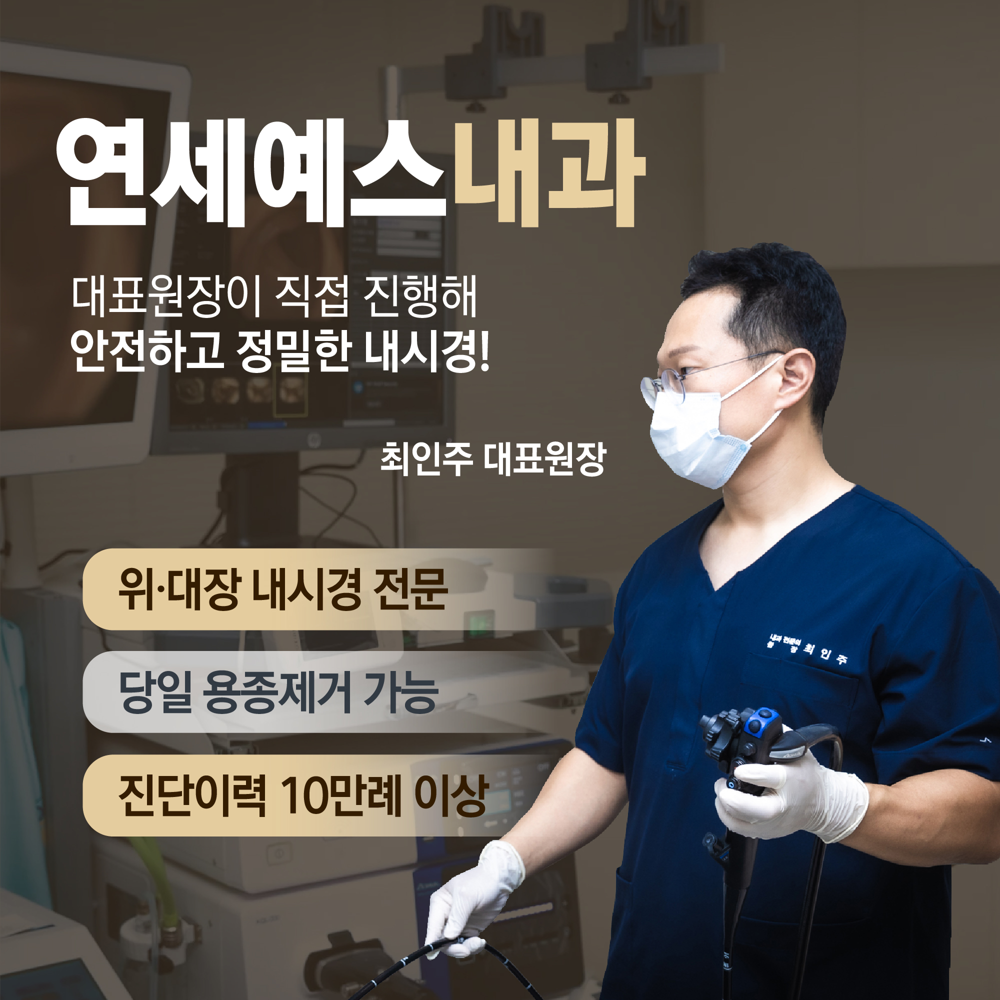
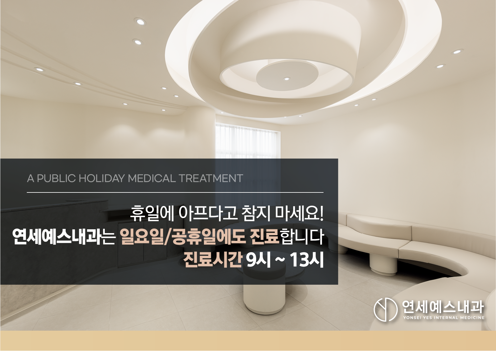
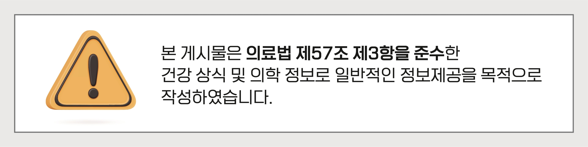

# [주안동영양수액내과연세예스내과]마운자로 효과, 임상 수치로 살펴보기

안녕하세요! 여러분의 건강 주치의 연세예스내과입니다. 😊

여름 막바지, 옷차림 앞에서 유난히 체중계 눈금이 신경 쓰이는 요즘이시죠? 최근 진료실에서는 **마운자로(성분명 티르제파타이드)**를 궁금해하시는 분들이 부쩍 늘었습니다.

**"그냥 식단으로 좀 더 버텨보자"** 하고 미루다가도, 정작 실제 임상 수치는 잘 모르고 계신 경우가 많으신데요. 오늘은 마운자로가 국내외 임상시험에서 확인된 체중감량·혈당 개선 수치를 중심으로, 다른 GLP-1 계열 약물과의 차이까지 시원하게 정리해 드리겠습니다!

---

## 1. 💊 마운자로, 무엇이 다르게 작용할까요?

마운자로의 성분명인 티르제파타이드는 **GIP(포도당의존성 인슐린분비 촉진 폴리펩타이드)**와 **GLP-1(글루카곤 유사 펩타이드-1)**, 두 가지 수용체에 동시에 결합하도록 설계된 이중작용제(dual agonist)입니다.

기존 위고비·오젬픽(세마글루타이드 성분)이나 삭센다(리라글루타이드 성분)가 GLP-1 수용체 하나에만 작용하는 것과 달리, 마운자로는 GIP 경로까지 함께 자극합니다. 두 호르몬 모두 인슐린 분비와 식욕·포만감 조절에 관여하는데, 두 경로가 동시에 움직이면서 대사 지표 개선 폭에 차이가 나타난다는 것이 여러 리뷰 논문의 공통된 설명입니다.

실제로 2형 당뇨병을 대상으로 한 SURPASS 임상 프로그램에서는 당화혈색소(HbA1c, 최근 2~3개월 평균 혈당을 나타내는 수치)가 **2%p 이상 감소**하고, 체중은 **15% 이상** 줄어든 결과가 보고됐습니다. **"약 하나로 혈당도, 체중도 같이 관리된다고?"** 라는 반응이 나오는 이유입니다.

---

## 2. 📈 SURMOUNT-1에서 확인된 체중 변화

마운자로의 체중 감량 효과를 보여주는 대표적 임상이 SURMOUNT-1입니다. 당뇨병이 없는 비만·과체중 성인을 72주간 관찰한 결과, **15mg 투여군의 평균 체중 감소율은 -22.5%**(위약군 -2.4%)로 확인됐습니다.

여기서 그치지 않았습니다. 같은 연구 대상자를 176주(3.4년)까지 연장 추적한 결과, 마운자로 투여군의 **2형 당뇨병 발생 위험은 위약군 대비 94% 낮게** 나타났습니다. 체중 감량 효과가 일시적 수치에 그치지 않고 장기간까지 이어졌다는 점이 특히 눈에 띕니다.

다만 이 수치는 약물을 꾸준히 복용한 경우를 기준으로 산출한 값으로, 통계 산출 방식에 따라 인용되는 숫자가 다소 다를 수 있다는 점도 참고해 주세요.

---

## Q. 마운자로와 위고비, 실제로 비교한 연구가 있나요?

네, **SURMOUNT-5**라는 head-to-head(직접 비교) 임상시험이 있습니다. 비당뇨 비만·과체중 성인 751명을 대상으로 72주간 마운자로와 세마글루타이드(위고비 성분)를 나란히 비교했습니다. 이 임상에서 확인된 최소제곱평균 체중 변화율은 **마운자로군 -20.2%, 세마글루타이드군 -13.7%**였습니다.

절대 체중 감소량으로는 마운자로군 22.8kg, 세마글루타이드군 15.0kg, 허리둘레는 각각 -18.4cm, -13.0cm 변화했습니다. 체중 10%·15%·20%·25% 이상 감량을 달성한 비율도 모두 마운자로군에서 더 높게 나타났습니다.

다만 이는 SURMOUNT-5라는 특정 임상시험, 특정 용량·기간 조건에서 확인된 수치입니다. 두 약물 모두 용량을 조절하는 단계에서는 경증~중등도의 위장관계 이상반응이 가장 흔하게 나타났다는 점도 함께 확인됐습니다.

---

## 3. ⚠️ 부작용과 반드시 확인해야 할 주의사항

좋은 수치만큼이나 꼼꼼히 살펴야 할 부분이 부작용입니다. 마운자로의 가장 흔한 이상반응은 **오심, 구토, 설사, 식욕저하, 변비, 상복부 불편감** 등 위장관계 증상입니다. 한 메타분석에서는 오심 발생률이 마운자로군 20.43%, 대조군 10.47%로 보고됐습니다(상대위험도 2.90배).

**"수치가 좋다고 해서 나한테도 잘 맞을까?"** 걱정되실 수 있는데, 이 부분은 반드시 의료진과 상의가 필요한 지점입니다. 특히 미국 FDA 라벨에는 동물실험에서 관찰된 갑상선 C세포 종양 관련 박스경고(Boxed Warning)가 포함되어 있고, 개인 또는 가족력상 수질성 갑상선암·다발성내분비선종 2형이 있다면 투여 금기로 명시되어 있습니다.

사람에서의 직접적인 관련성은 아직 확인되지 않았지만, 처방 전 병력을 의료진과 함께 확인하는 과정은 꼭 필요합니다. 심혈관계 안전성 관련해서는 지금까지의 메타분석·사후분석에서 주요 심혈관 사건 위험 증가는 관찰되지 않았습니다.

---

## ✅ 마운자로 핵심 수치, 한눈에 정리

| 임상시험 | 비교 대상 | 기간 | 확인된 결과 |
|------|---------|------|-----------|
| SURMOUNT-1 | 위약 | 72주 | 체중 변화율 최대 -22.5%(위약 -2.4%) |
| SURMOUNT-1 연장 | 위약 | 176주(3.4년) | 당뇨병 진행 위험 94% 감소 |
| SURMOUNT-5 | 세마글루타이드 | 72주 | 마운자로 -20.2% vs 세마글루타이드 -13.7% |

투여를 고려하고 계시다면, 아래 항목을 먼저 체크해 보고 진료실에서 함께 상담해 보시기 바랍니다.

[   ] 갑상선암 가족력이나 다발성내분비선종 병력이 있다

[   ] 현재 당뇨병 치료제나 인슐린을 병용 중이다

[   ] 임신 중이거나 임신을 계획하고 있다

[   ] 위장관계 질환이 있거나 관련 약물에 민감했던 경험이 있다

> **"수치는 확인하되, 나에게 맞는지는 반드시 진료실에서 확인하세요."**

체중 관리나 혈당 관리에 대한 고민이 있으시다면, 자가 판단으로 약물을 결정하기보다 **가까운 내과**에 방문하셔서 현재 건강 상태에 맞는 방법을 상담받아 보시길 권해드립니다.

---

※ 모든 치료 및 예방접종은 개인의 상태에 따라 발열, 통증, 알레르기 반응 등의 부작용이 나타날 수 있으므로, 반드시 의료진과 충분한 상담 후 진행하시기 바랍니다.

연세예스내과에서 전해드리는 건강 정보였습니다. 오늘도 건강하고 평안한 하루 보내세요!

---

#마운자로 #티르제파타이드 #GLP1비만치료 #옛시민회관의원 #옛시민회관내과의원 #옛시민회관사거리내과 #옛시민회관사거리의원 #옛시민회관사거리내과의원 #석바위내과 #석바위의원
