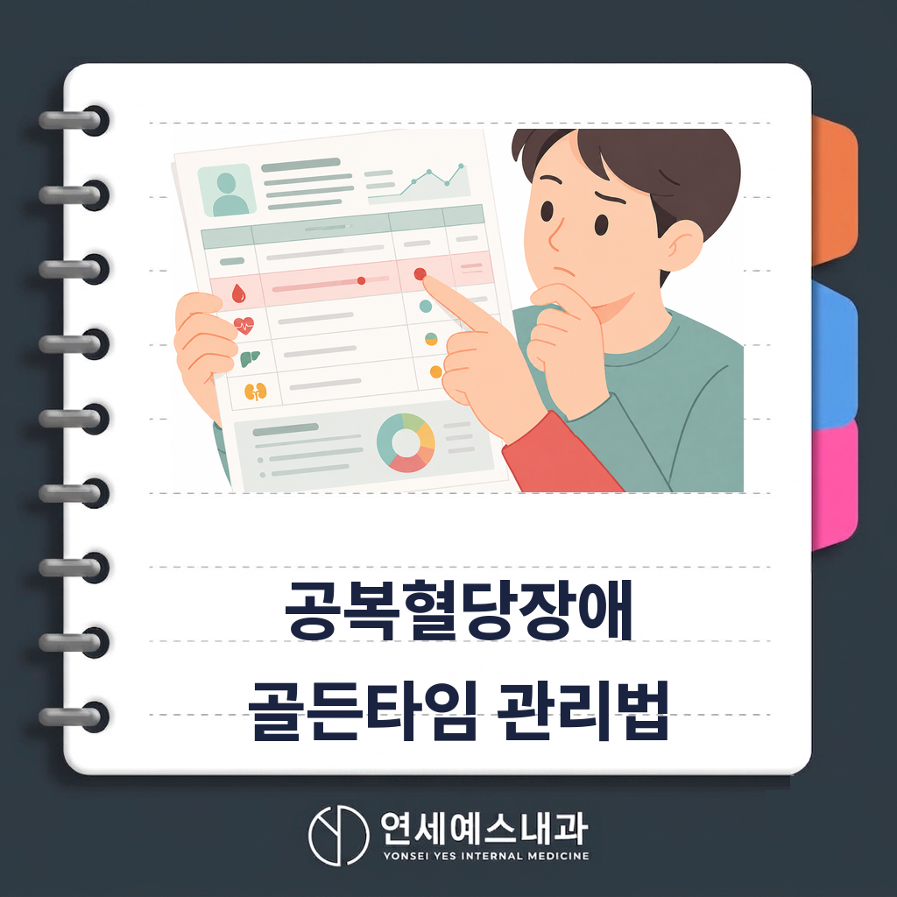
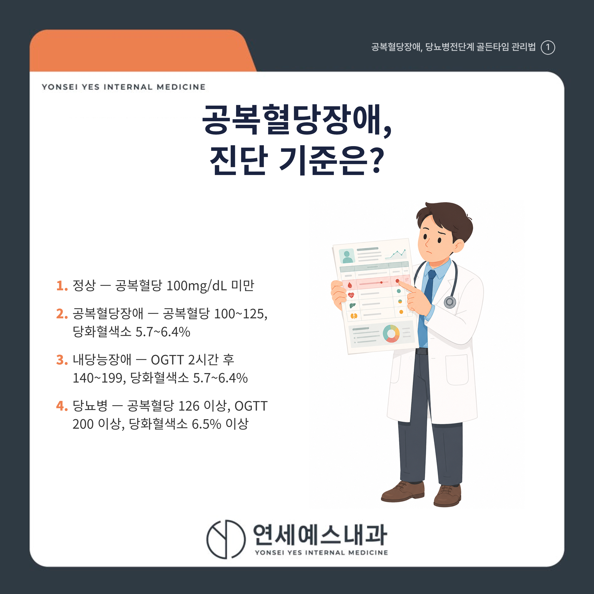
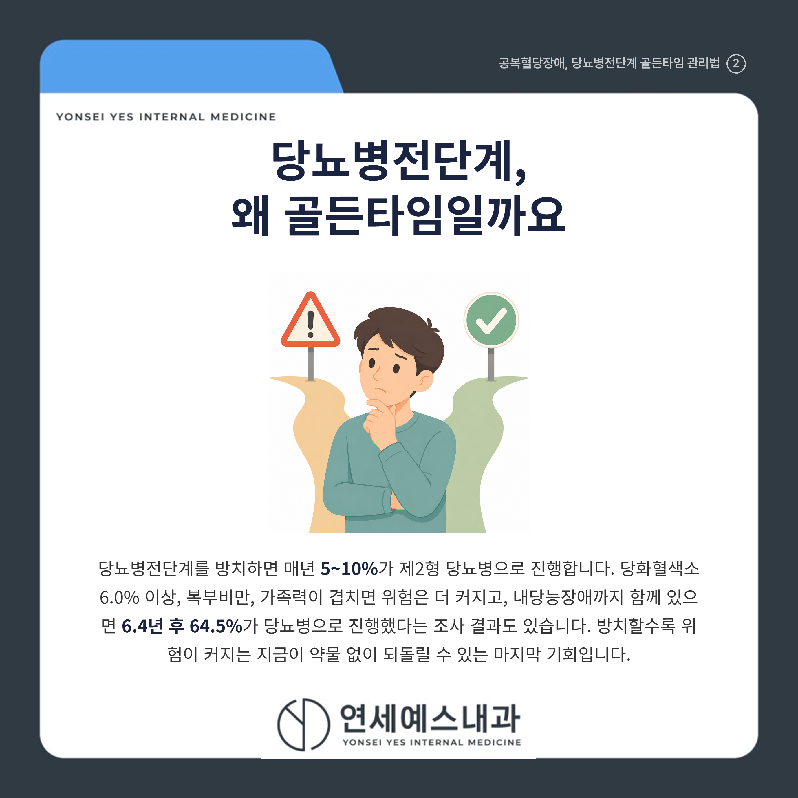
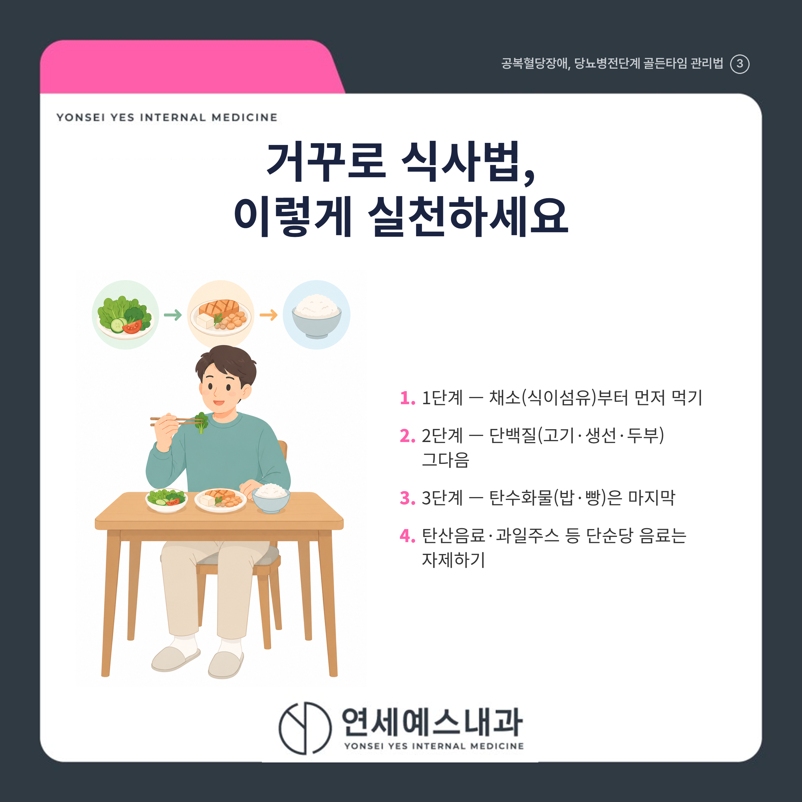
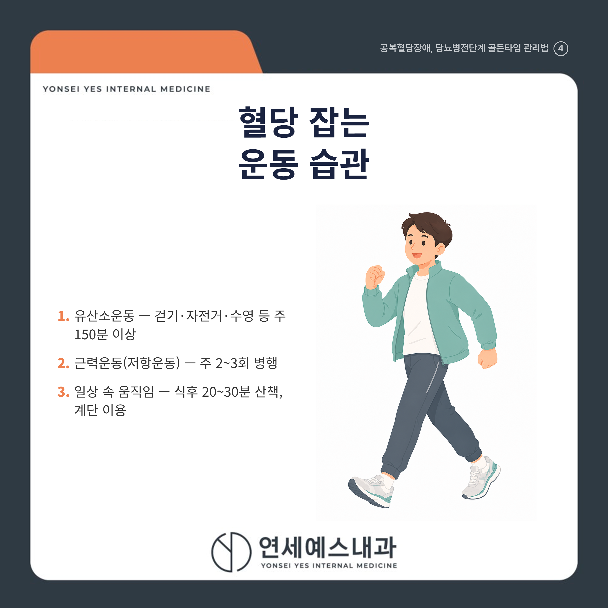
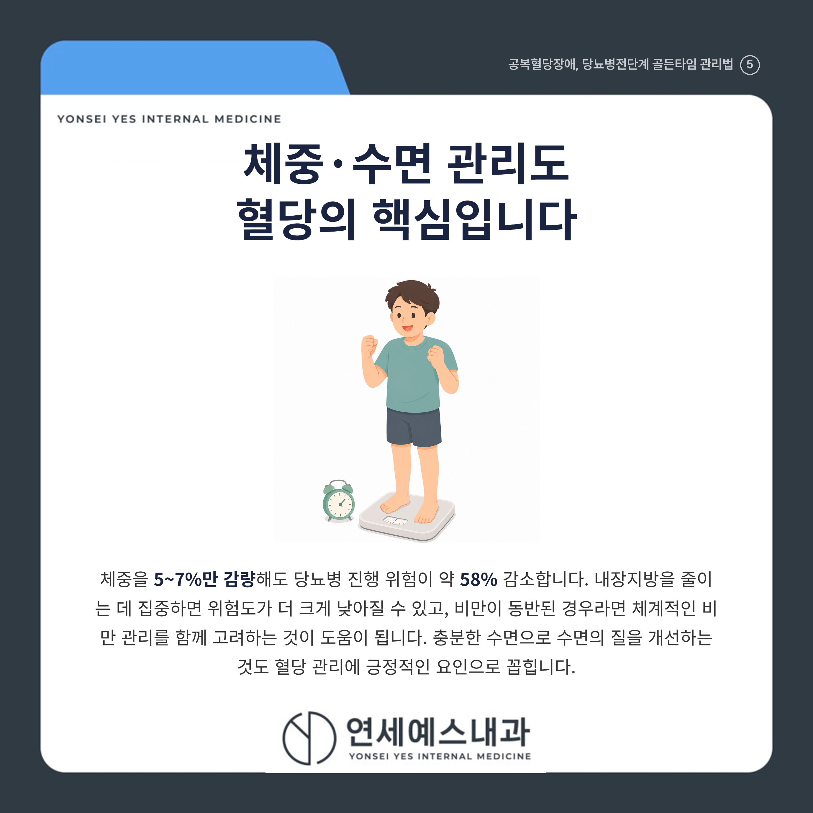

# [주안동초음파내과연세예스내과]공복혈당장애, 당뇨병전단계 골든타임 관리법

안녕하세요! 여러분의 건강 주치의 연세예스내과입니다. 😊

무더위가 한창인 요즘, 여름철 건강검진을 받고 오신 분들 많으시죠? 검사 결과표에서 평소보다 살짝 높은 공복혈당 수치를 발견하고 마음 한구석이 무거워지신 분도 계실 것 같습니다.

그런데 **"숫자가 조금 높다고 해도 당뇨병은 아니잖아, 괜찮겠지"** 라고 생각하며 결과표를 서랍 속에 넣어두신 적 없으신가요? 공복혈당장애는 아직 당뇨병은 아니지만, 정상 혈당도 아닌 애매한 경계 상태라 자칫 방치하기 쉽습니다.

오늘은 공복혈당장애, 즉 당뇨병전단계가 정확히 무엇이고 왜 '골든타임'이라 불리는지, 그리고 생활 속에서 어떻게 관리할 수 있는지 자세히 알려드리려고 합니다.

---

## 1. 🩺 공복혈당장애란 무엇인가요?

공복혈당장애(impaired fasting glucose)란 8시간 이상 금식한 뒤 측정한 공복혈당이 100~125 mg/dL인 상태를 말합니다. 정식 당뇨병 진단 기준인 126 mg/dL에는 못 미치지만, 정상 수치인 100 mg/dL 미만도 아닌 경계 구간이죠.

이런 상태를 흔히 '당뇨병전단계'라 부르며, 공복혈당장애 외에도 내당능장애(경구당부하검사 2시간 후 140~199 mg/dL), 당화혈색소(HbA1c) 5.7~6.4% 중 하나만 해당해도 당뇨병전단계로 분류됩니다.

| 구분 | 공복혈당 | OGTT 2시간 후 | 당화혈색소 |
|------|---------|-------------|-----------|
| 정상 | 100 미만 | 140 미만 | - |
| 공복혈당장애 | 100~125 | - | 5.7~6.4% |
| 내당능장애 | - | 140~199 | 5.7~6.4% |
| 당뇨병 | 126 이상 | 200 이상 | 6.5% 이상 |

국내 30세 이상 성인의 **41.1%**, 65세 이상은 **47.7%**가 당뇨병전단계에 해당할 만큼 매우 흔한 상태이며, 별다른 증상이 없어 건강검진에서 우연히 발견되는 경우가 대부분입니다.

---

## 2. ⏳ 방치하면 위험한 이유, '골든타임'

공복혈당장애를 가볍게 넘기면 안 되는 이유는 당뇨병으로 진행할 수 있다는 점 때문입니다. 국제 학술 문헌은 당뇨병전단계에서 제2형 당뇨병으로 진행하는 비율을 **연간 약 5~10%**(자료에 따라 최대 18%)로 보고합니다.

당화혈색소 6.0% 이상, 복부비만, 당뇨병 가족력 같은 위험 인자가 겹치면 진행 위험은 더 높아집니다. 대한당뇨병학회 자료에서는 내당능장애 방치 시 7.5년 후 34%가, 공복혈당장애와 내당능장애를 함께 가진 경우 6.4년 후 64.5%가 당뇨병으로 진행했다는 결과도 확인됩니다.

두 수치가 다르게 느껴지실 수 있지만, '연간 발생률'과 '수년간 누적 진행률'이라는 계산 방식과 위험 인자 동반 여부의 차이일 뿐, **방치할수록 진행 위험이 커진다는 사실은 동일합니다.** 그래서 전문가들은 이 단계를 약물 없이 정상 혈당으로 되돌릴 수 있는 마지막 기회, '골든타임'이라 부릅니다.

---

## 3. 🥗 식습관 교정으로 혈당 관리하기

다행히 공복혈당장애는 생활습관 교정만으로 정상 혈당으로 되돌릴 수 있는 단계입니다. 가장 쉬운 방법은 이른바 '거꾸로 식사법'입니다. 채소(식이섬유) → 단백질(고기·생선·두부) → 탄수화물(밥·빵) 순서로 먹으면 식후 혈당이 완만하게 오릅니다.

20분 이상 천천히 먹기, 흰쌀밥·흰빵 대신 잡곡밥·현미밥 선택, 탄산음료·과일주스 같은 단순당 음료 자제도 함께 실천하면 좋습니다. 채소·통곡물·불포화지방 중심의 지중해식 식단도 참고할 만합니다.

---

## 4. 🏃 운동으로 혈당 관리하기

대한당뇨병학회는 걷기·자전거·수영 같은 **유산소운동**과 **저항운동(근력운동)**을 함께 할 것을 권고합니다. 중강도 유산소운동은 주 150분 이상, 근력운동은 주 2~3회 병행하는 것이 좋습니다.

거창한 운동이 아니어도 괜찮습니다. 식후 20~30분 뒤 가볍게 산책하거나 계단을 이용하는 일상 속 움직임도 식후 혈당 관리에 도움이 됩니다. **조금씩이라도 꾸준히 몸을 움직이는 습관**이 핵심입니다.

---

## 5. ⚖️ 체중·수면 등 나머지 생활습관

식이·운동 못지않게 중요한 것이 체중 관리입니다. 체중을 **5~7%만 감량**해도 당뇨병 진행 위험이 약 58% 감소하며, 내장지방을 줄이는 데 집중하면 위험도가 더 큰 폭으로 낮아질 수 있습니다.

비만이 동반된 경우라면 필요에 따라 비만 관리를 함께 고려하는 것이 도움이 됩니다. 충분한 수면으로 수면의 질을 개선하는 것도 혈당 관리에 긍정적인 요인으로 꼽힙니다.

---

## Q. 검진은 얼마나 자주 받아야 하나요?

국내 국가건강검진은 만 40세 이상을 대상으로 원칙적으로 **2년에 1회**(비사무직은 매년) 시행되며 공복혈당 검사가 포함됩니다. 미국당뇨병학회(ADA)는 만 35세부터 선별검사를 시작해, 결과가 정상이면 최소 3년 간격, 당뇨병전단계로 확인됐다면 **매년 재검사**를 권고합니다.

한 번 공복혈당장애 판정을 받았다면 다음 건강검진까지 기다리지 말고, 매년 공복혈당을 확인하는 것이 안전합니다.

---

## ✅ 공복혈당장애 관리 체크리스트

아래 항목 중 지키지 못하고 있는 것이 있다면 오늘부터 하나씩 실천해 보세요.

[   ] 채소 → 단백질 → 탄수화물 순서로 식사하고 있다

[   ] 흰쌀밥·흰빵 대신 잡곡밥·현미밥을 선택하고 있다

[   ] 주 150분 이상 유산소운동, 주 2~3회 근력운동을 하고 있다

[   ] 식후 20~30분 가벼운 산책이나 계단 이용을 실천하고 있다

[   ] 체중의 5~7% 감량을 목표로 관리하고 있다

> **"공복혈당장애는 병이 아니라, 병을 막을 수 있는 마지막 기회입니다."**

공복혈당장애는 아직 당뇨병이 아닙니다. 하지만 방치하면 당뇨병으로 이어질 수 있고, 반대로 식습관과 운동을 조금만 바꾸면 정상 혈당으로 되돌릴 수 있는 단계이기도 합니다. 건강검진 결과표에서 공복혈당 수치가 100을 넘었다면, 가까운 내과를 방문해 정확한 검사와 상담을 받아보시기 바랍니다.

---

※ 모든 치료 및 예방접종은 개인의 상태에 따라 발열, 통증, 알레르기 반응 등의 부작용이 나타날 수 있으므로, 반드시 의료진과 충분한 상담 후 진행하시기 바랍니다.

연세예스내과에서 전해드리는 건강 정보였습니다. 오늘도 건강하고 평안한 하루 보내세요!

---

#공복혈당장애 #당뇨병전단계 #혈당관리 #주안내과의원 #주안역내과 #주안역의원 #주안역내과의원 #시민공원역내과 #시민공원역의원 #시민공원역내과의원
