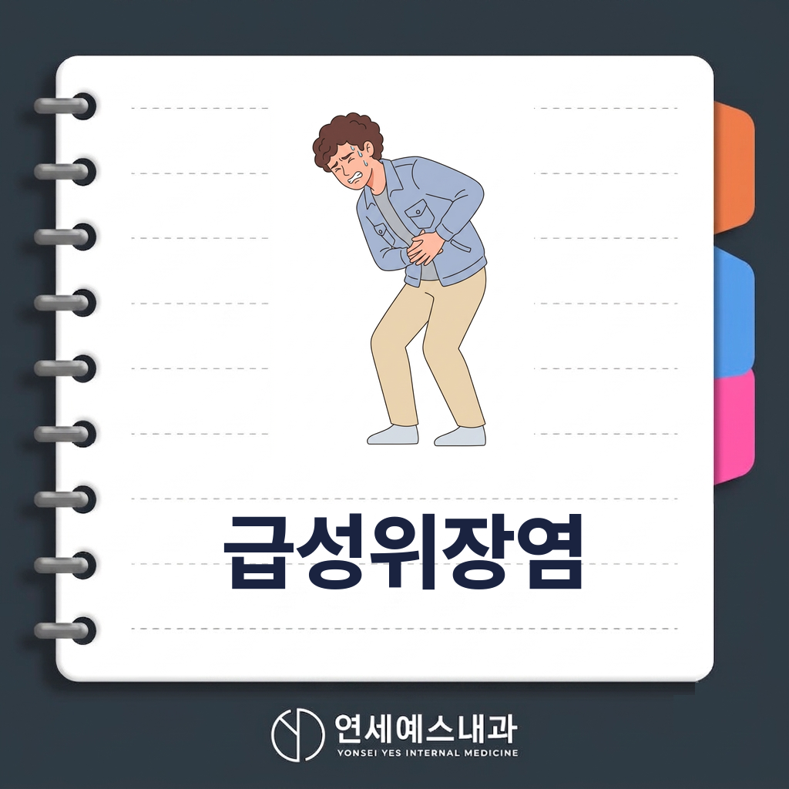
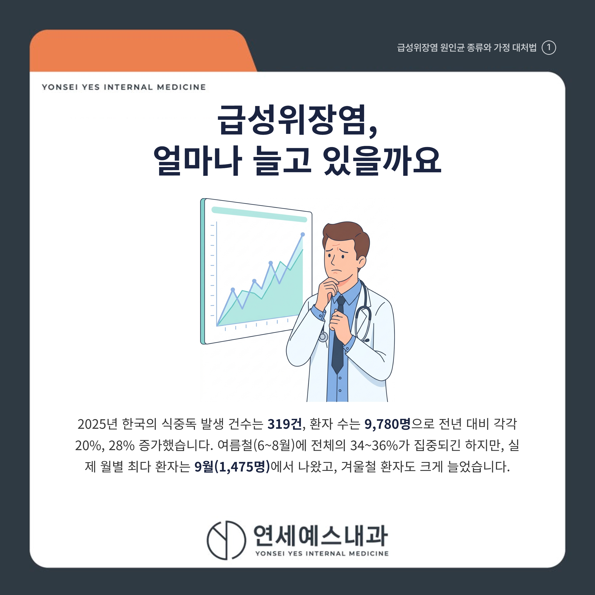
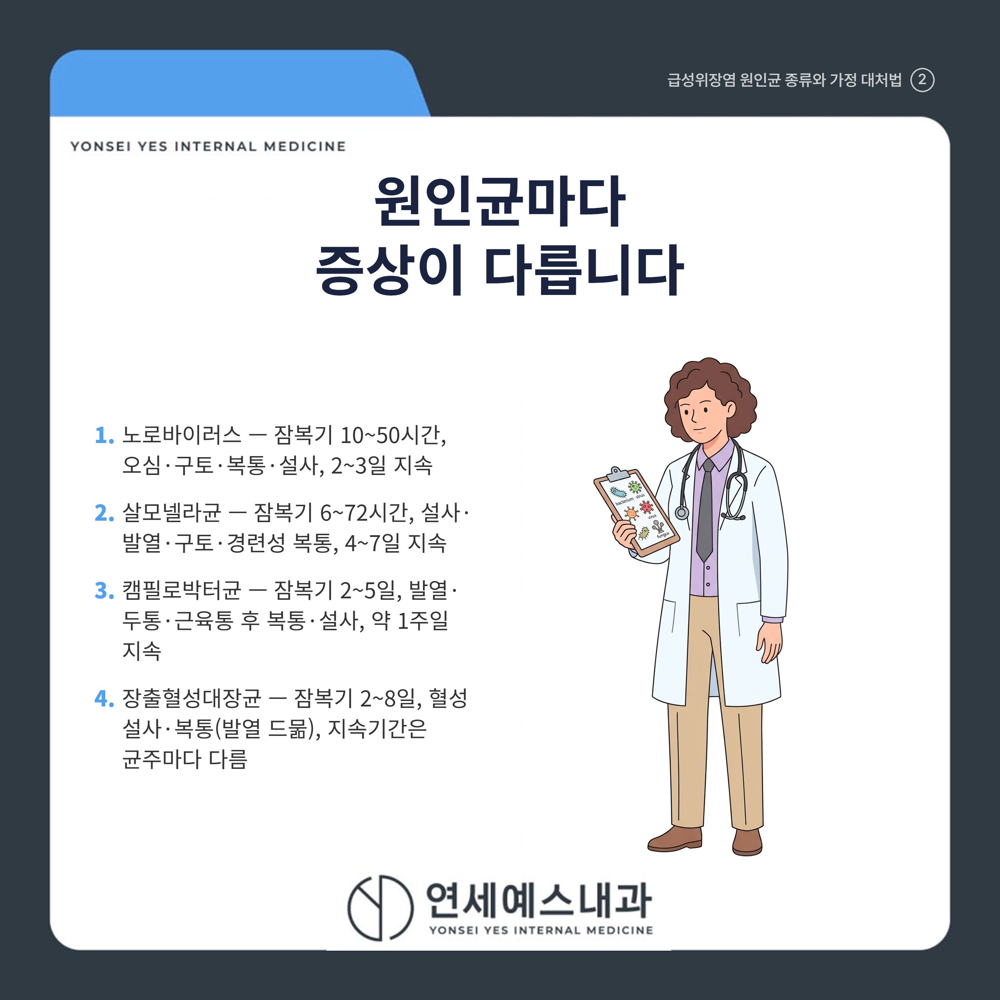
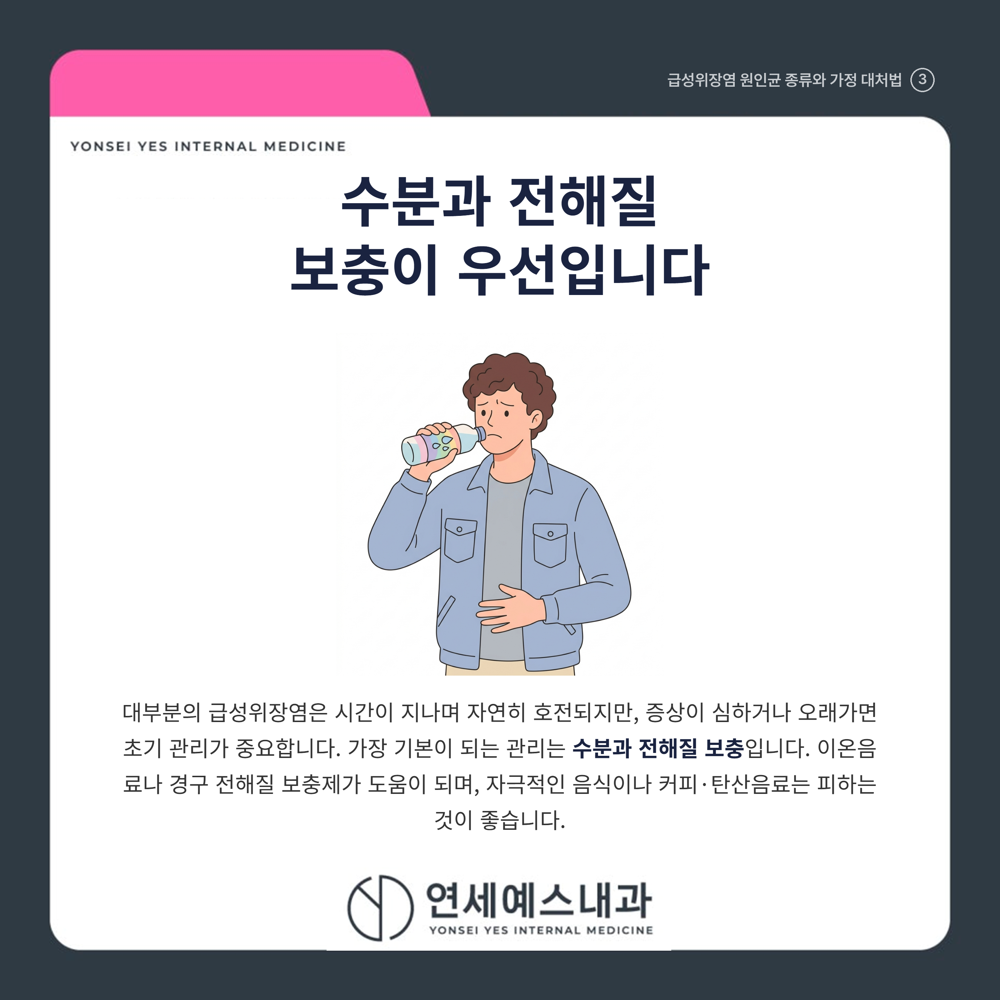
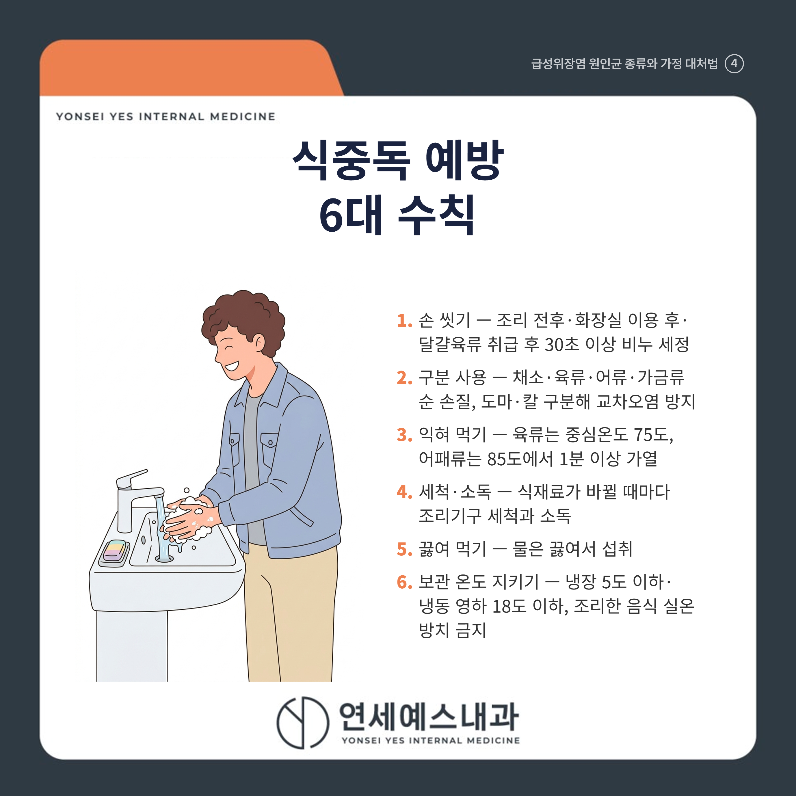

# [주안동휴일진료내과연세예스내과] 급성위장염 원인균 종류와 가정 대처법

안녕하세요! 여러분의 건강 주치의 연세예스내과입니다. 😊

여름철 물놀이와 별미 먹거리 뒤에는 **급성위장염(식중독)** 위험이 따라옵니다.

하지만 ==초가을과 겨울에도 환자가 크게 늘고 있어== 계절과 상관없이 배탈·설사를 가볍게 넘기면 안 됩니다.

오늘은 급성위장염 원인균의 특징과 가정 대처법을 정리해 드리겠습니다.

---

## 1. 🦠 급성위장염, 얼마나 늘고 있을까요?

**급성위장염(식중독)**은 오염된 음식이나 물로 바이러스·세균·기생충이 위장관에 침투해 염증을 일으키는 질환입니다. 설사, 구토, 복통이 대표 증상입니다.

2025년 국내 식중독은 319건, 환자 9,780명으로 전년 대비 건수 20%, 환자 28% 늘었습니다.

여름(6~8월)에 34~36%가 몰리지만, 월별 최다 환자는 **9월(1,475명)**에서 나왔고 겨울철 환자도 712명에서 1,625명으로 급증했습니다.

2025년 원인균 1위는 **살모넬라균**(환자 4,248명, 전체의 43%), 2위는 **노로바이러스**(환자 1,632명)였습니다.

---

## 2. 🔍 원인균마다 증상과 잠복기가 다릅니다

같은 급성위장염이라도 원인균에 따라 잠복기와 증상, 지속 기간이 다릅니다.

| 병원체 | 잠복기 | 주요 증상 | 지속 기간 |
|---|---|---|---|
| 노로바이러스 | 10~50시간 | 오심, 구토, 복통, 설사 | 2~3일 |
| 살모넬라균 | 6~72시간 | 설사, 발열, 구토, 경련성 복통 | 4~7일 |
| 캠필로박터균 | 2~5일 | 발열·두통·근육통 뒤 복통·설사 | 약 1주일 |
| 장출혈성대장균 | 2~8일 | 혈성 설사, 복통(발열 드묾) | 균주에 따라 다름 |

**노로바이러스**는 유행성 설사 질환의 약 90%를 차지하며, 굴 등 어패류나 오염된 물, 감염자 접촉으로 전파됩니다.

**살모넬라균**은 달걀과 취급 과정의 교차오염이, **캠필로박터균**은 덜 익힌 닭고기 등 가금류 섭취가 주요 감염 경로입니다.

---

## 3. 🏠 가정에서는 이렇게 대처하세요

대부분은 시간이 지나며 자연히 호전됩니다. 다만 증상이 심하거나 오래가면 탈수·전해질 불균형으로 이어질 수 있어 초기 관리가 중요합니다.

가장 기본은 **수분과 전해질 보충**입니다. 이온음료나 경구 전해질 보충제가 도움이 되며, 자극적인 음식과 커피·탄산음료는 피하세요.

> ⚠️ 지사제·항생제 임의 복용 주의
> ==혈변이나 고열이 있을 때 지사제를 함부로 먹으면== 세균과 독소 배출이 막혀 증상이 더 길어질 수 있습니다. 항생제는 바이러스성 위장염에 효과가 없고, 세균성이라도 처방된 용법과 기간을 지켜야 내성균을 막습니다.

---

## 4. 🚨 이런 증상이면 병원에 가야 합니다

아래 신호가 하나라도 있으면 자가 관리보다 **가까운 내과** 진료가 안전합니다.

[   ] 혈변, 점액·고름 섞인 변, 타르처럼 검은 변이 보인다

[   ] 갑작스럽고 심한 복통이 있다

[   ] 소변량이 줄고 어지럼증 등 탈수 증상이 있다

[   ] 39~40도 이상 고열이 2~3일 넘게 지속된다

[   ] 구토가 하루 이상, 심한 물설사가 반복된다

[   ] 의식이 흐려지거나 심한 무기력감이 나타난다

==소아, 고령자, 만성질환자는 탈수와 합병증 진행이 빠릅니다.== 특히 장출혈성대장균 감염은 드물게 **용혈요독증후군(HUS, 신부전을 동반할 수 있는 합병증)**으로 진행할 수 있어, 혈변이 동반된 설사는 특히 주의해야 합니다.

---

## 5. 🛡️ 식중독 예방 6대 수칙

식약처가 안내하는 예방 수칙입니다.

1. **손 씻기**: 조리 전후·화장실 후·달걀·육류 취급 후 30초 이상
2. **칼·도마 구분**: 채소 → 육류 → 어류 → 가금류 순으로 손질해 교차오염 방지
3. **익혀 먹기**: 육류는 중심온도 75도, 어패류는 85도에서 1분 이상
4. **세척·소독**: 식재료가 바뀔 때마다 조리기구 세척·소독
5. **끓여 먹기**: 물은 끓여서 섭취
6. **온도 지키기**: 냉장 5도 이하·냉동 영하 18도 이하, 조리한 음식은 실온에 오래 두지 않기

> 💡 원인균별 예방 포인트
> 살모넬라는 달걀을 만진 뒤 꼭 손을 씻고, 캠필로박터는 닭고기 등 가금류를 충분히 익혀 먹는 것이 핵심입니다.

---

## Q. 식중독은 여름에만 조심하면 되나요?

아닙니다. 앞서 봤듯 월별 최다 환자는 9월에 나왔고, 겨울철 환자도 두 배 넘게 늘었습니다.

손 씻기와 익혀 먹기 습관을 사계절 꾸준히 지키는 것이 가장 확실한 예방법입니다.

---

> **"설사와 구토는 몸이 보내는 경고 신호입니다. 며칠 참고 넘기기보다 원인을 확인하는 것이 먼저입니다."**

**급성위장염** 증상이 가볍다고 방치하지 마시고, 혈변이나 고열 등 위험 신호가 보이면 미루지 말고 **가까운 내과**에서 진료받아 보시기 바랍니다.

---

※ 모든 치료 및 예방접종은 개인의 상태에 따라 발열, 통증, 알레르기 반응 등의 부작용이 나타날 수 있으므로, 반드시 의료진과 충분한 상담 후 진행하시기 바랍니다.

연세예스내과에서 전해드리는 건강 정보였습니다. 오늘도 건강하고 평안한 하루 보내세요!

---

#급성위장염 #식중독 #장염증상 #대장내시경 #검진 #주안동내과 #주안동의원 #주안동내과의원 #주안내과 #주안의원
