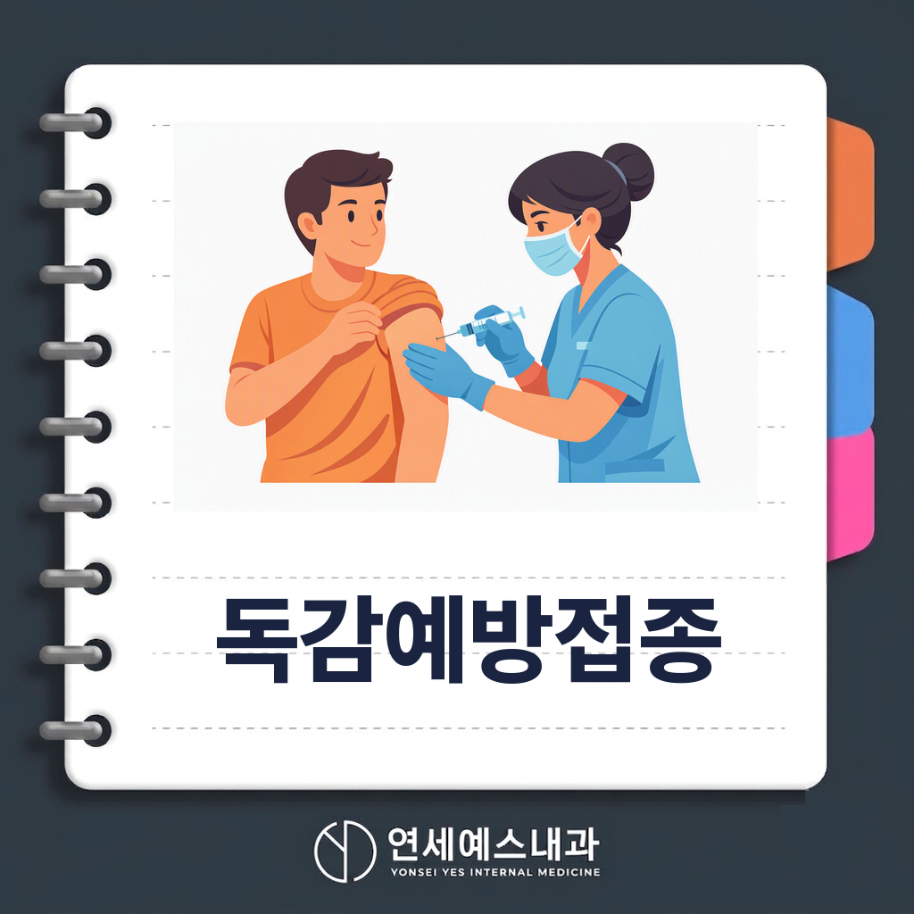
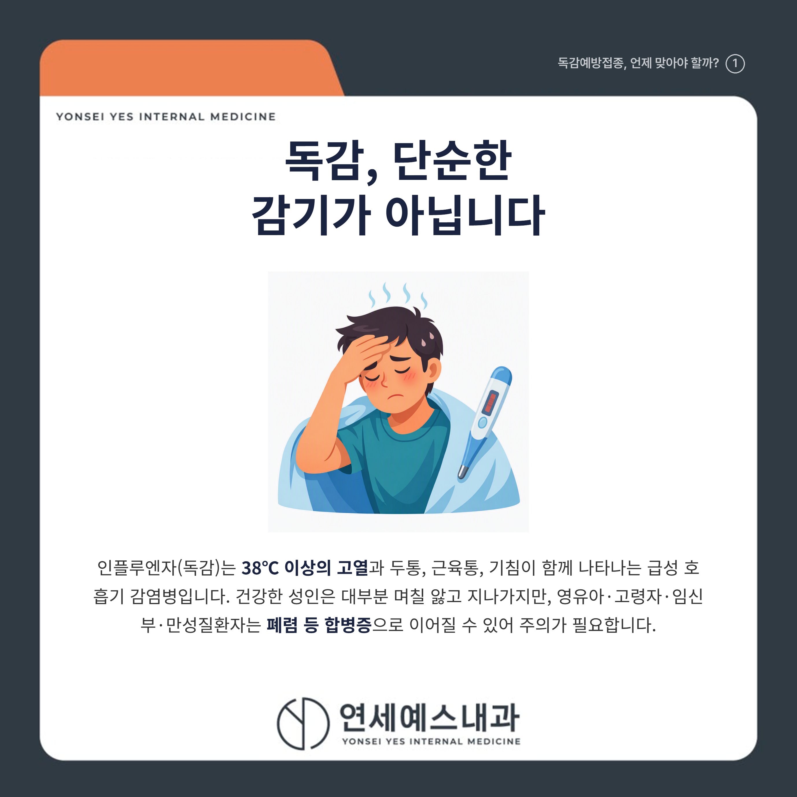
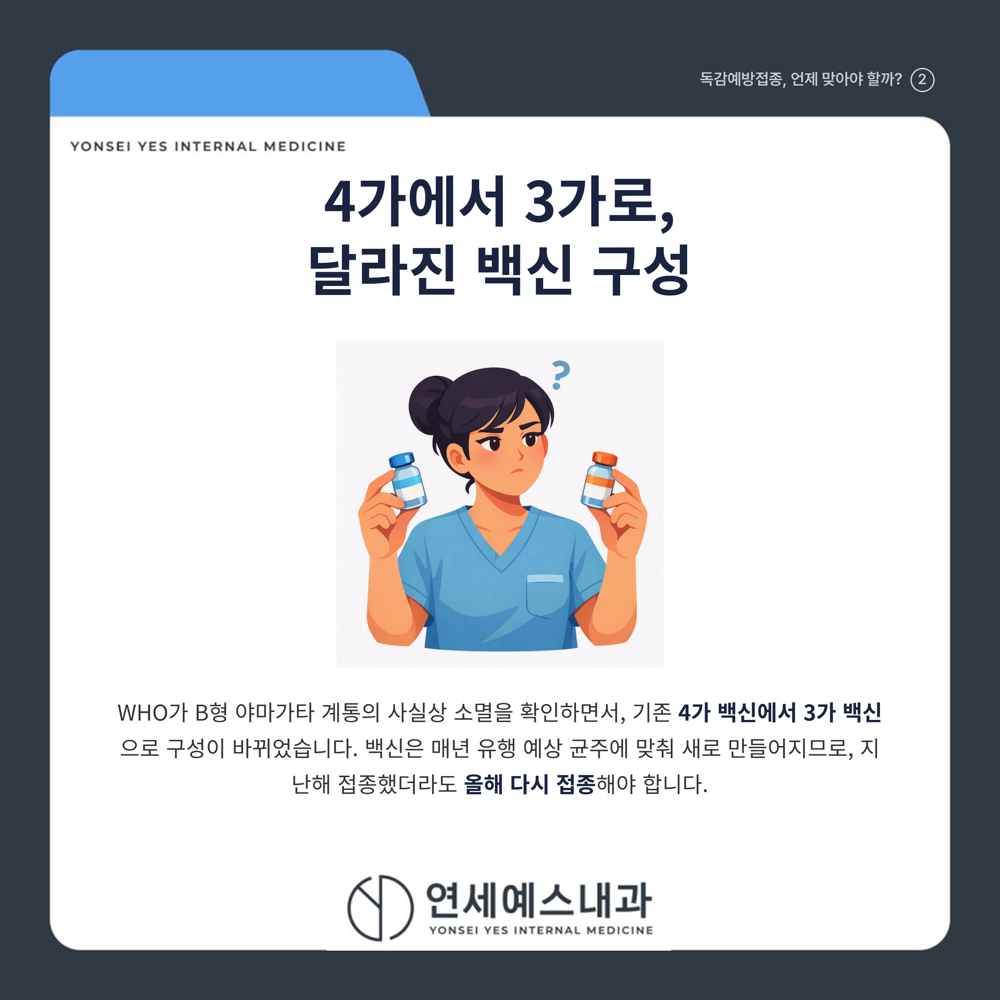
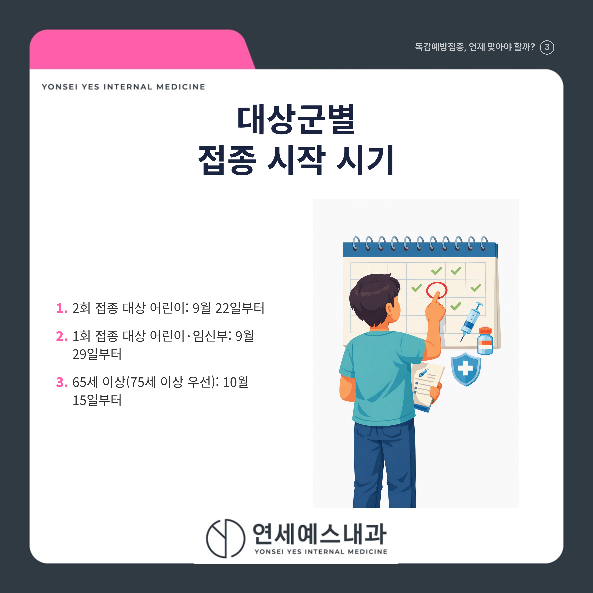
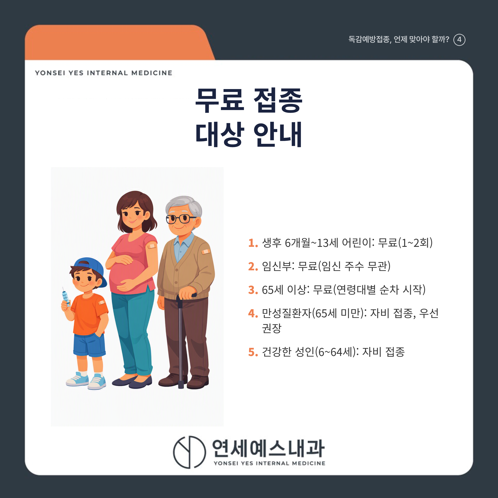
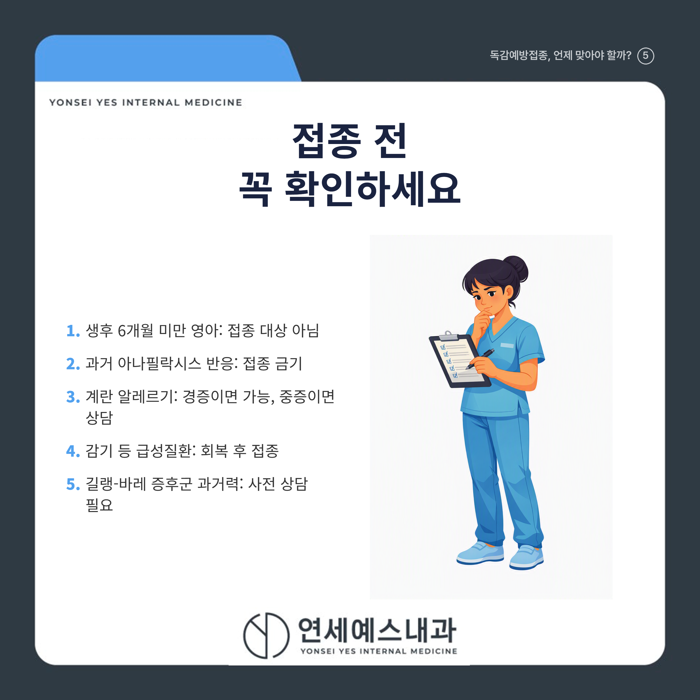
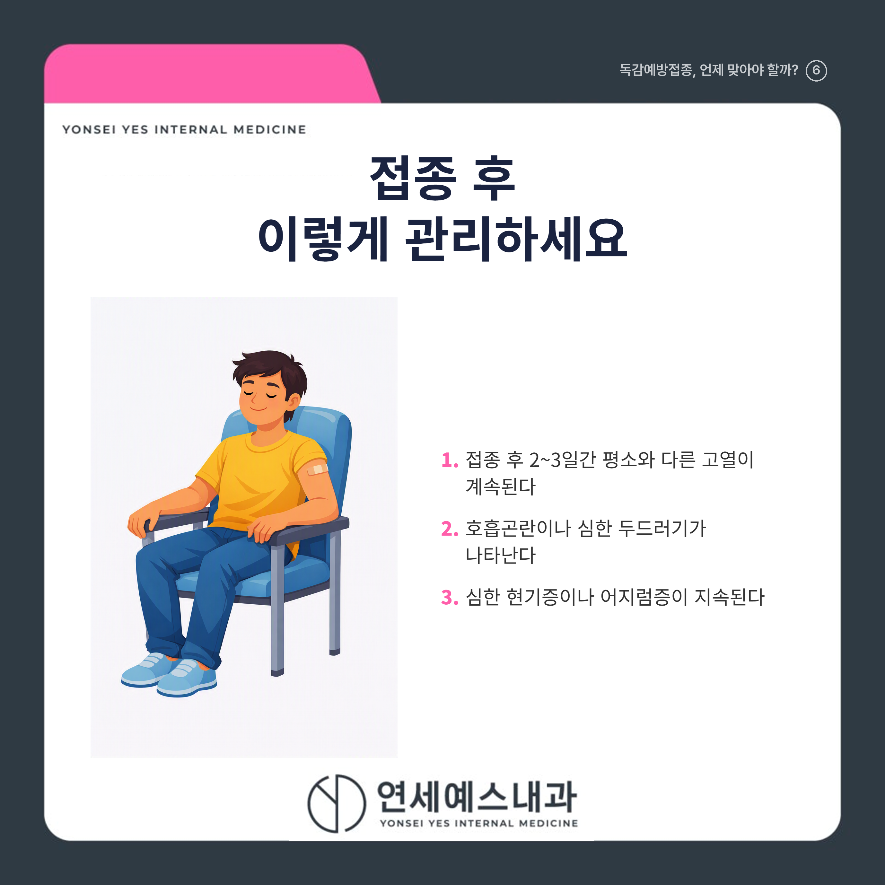
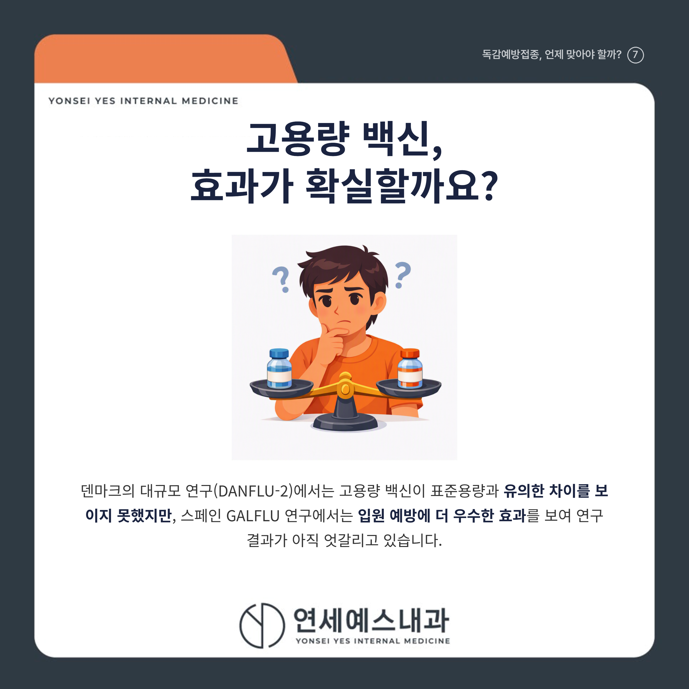

# [주안동혈액검사내과연세예스내과]독감예방접종 시기와 대상, 언제 맞아야 할까?

안녕하세요! 여러분의 건강 주치의 연세예스내과입니다. 😊

선선한 바람이 부는 걸 보니 가을이 왔네요. 환절기엔 독감예방접종이 떠오르시죠?

**"작년에 맞았으니 올해는 패스"** 하셨다면, ==인플루엔자는 매년 균주가 달라져 새로 접종해야== 합니다.

오늘은 **독감예방접종** 시기와 대상을 정리해 드릴게요.

---

## 1. 🍂 독감, 단순한 감기가 아닙니다

인플루엔자는 **38℃ 이상의 고열**, 두통, 근육통, 기침이 함께 오는 급성 호흡기 질환입니다.

==영유아·고령자·임신부·만성질환자는 폐렴 등 합병증 위험==이 있어 방심은 금물입니다.

## 2. 💊 이번 절기, 백신 구성이 달라졌습니다

기존 4가 백신에서, WHO 권고에 따라 2025-2026절기부터 **3가 백신**으로 국가예방접종 구성이 바뀌었습니다.

백신은 매년 새로 만들어지므로, 작년 접종 여부와 관계없이 올해도 다시 맞아야 합니다.

---

## 3. 📅 접종은 언제가 좋을까요?

대상군별로 9월 말~10월 중순 순차적으로 시작되며, 항체 형성엔 약 2주가 걸립니다.

유행 전인 **9~10월 접종**이 권장되지만, 시기를 놓쳤어도 유행 중이라면 접종은 여전히 의미가 있습니다.

## 4. 📋 무료 접종 대상, 나도 해당될까요?

| 대상 | 지원 여부 |
|------|----------|
| 생후 6개월~13세 | 무료 |
| 임신부 | 무료 |
| 65세 이상 | 무료 |
| 만성질환자·건강한 성인 | 자비 |

전국 위탁의료기관과 보건소 어디서든 접종할 수 있습니다.

---

## Q. 만성질환자는 꼭 맞아야 하나요?

네, 꼭 맞으시는 것이 좋습니다. ==만성질환자는 독감 감염 시 입원 위험이 약 6배, 뇌졸중 위험은 약 3배 높아집니다==.

그런데도 만성질환자의 약 49%는 자신이 고위험군인지 모르고 있었습니다. 해당하신다면 우선 접종 대상입니다.

> ⚠️ 접종 전 반드시 확인하세요
> ==생후 6개월 미만 영아, 과거 아나필락시스 반응 병력==이 있다면 접종 금기입니다. 급성질환·길랭-바레 증후군 과거력이 있다면 접종 전 의료진과 상담하세요.

---

## 5. 🩹 접종 후 이렇게 관리하세요

접종 부위 통증은 15~20%, 발열 등 전신 반응은 약 1%에서 나타나며 대부분 **48시간 이내** 사라집니다.

> 💡 접종 후 관리 팁
> 20~30분은 접종 기관에 머물고, 당일은 과음·과격한 운동을 피하세요.

[   ] 2~3일간 고열이 계속된다

[   ] 호흡곤란이나 심한 두드러기가 나타난다

[   ] 심한 현기증이 지속된다

해당한다면 즉시 가까운 내과를 방문해 진료받으시기 바랍니다.

## 6. 🔍 고령자 고용량 백신, 효과가 확실할까요?

해외 연구 결과는 아직 엇갈립니다. 국내 국가예방접종은 고용량이 아닌 일반 백신을 쓰므로 참고 수준으로만 알아두세요.

---

> **"올해도 괜찮겠지가 아니라, 올해도 새로 맞아야 한다는 것을 잊지 마세요."**

만성질환이 있거나 고위험군에 해당한다면, 가까운 내과에서 상담받아 보시기 바랍니다.

---

※ 모든 치료 및 예방접종은 개인의 상태에 따라 발열, 통증, 알레르기 반응 등의 부작용이 나타날 수 있으므로, 반드시 의료진과 충분한 상담 후 진행하시기 바랍니다.

연세예스내과에서 전해드리는 건강 정보였습니다. 오늘도 건강하고 평안한 하루 보내세요!

---

#독감예방접종 #인플루엔자백신 #가을철건강 #주안사거리내과 #주안사거리의원 #주안사거리내과의원 #미추홀내과 #미추홀의원 #미추홀내과의원 #옛시민회관내과
